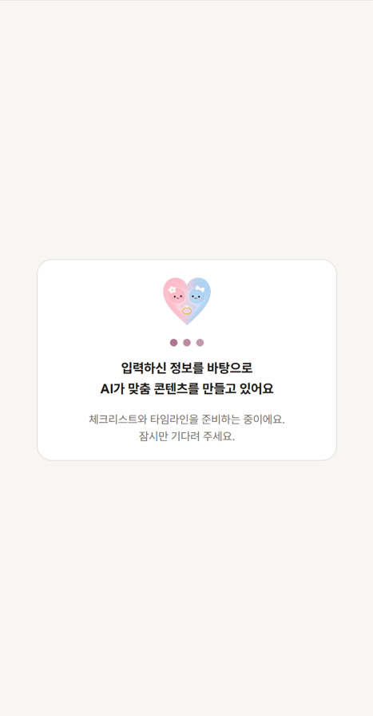
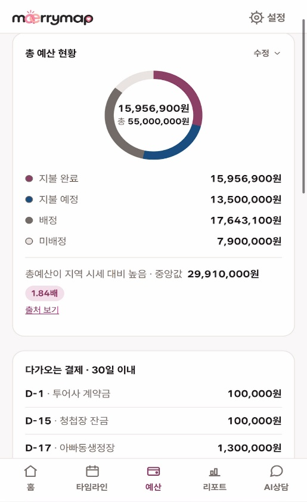
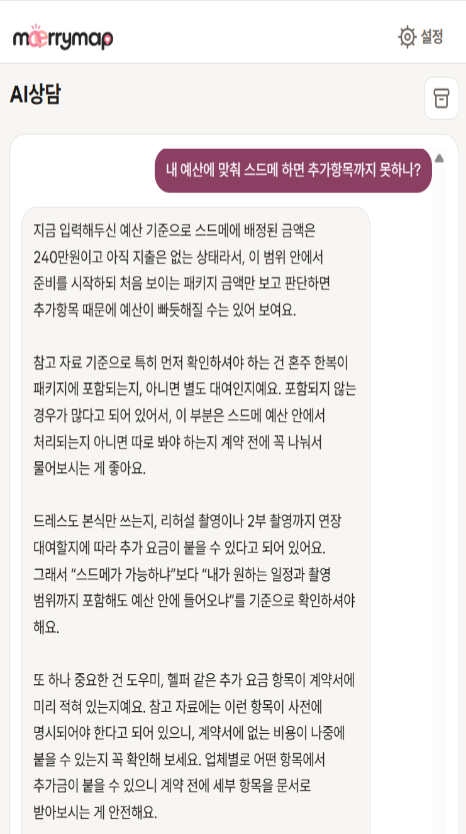
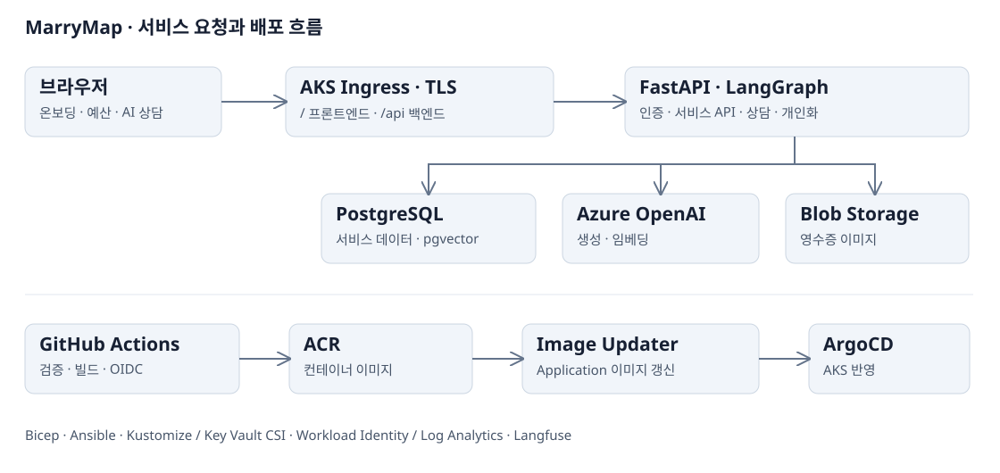

# MarryMap 메리맵

**결혼 준비의 예산·일정·계약 전 확인 사항을 관리하고, 공개 자료에 근거한 AI 상담을 제공하는 웹 서비스입니다.**

추가 비용과 계약 해지 조건, 업체별 납부일을 따로 찾아 관리해야 하는 불편에서 출발했습니다. 사용자 조건에 맞는 체크리스트와 타임라인을 만들고, 준비 현황·지출·상담을 하나의 흐름으로 연결했습니다.

<p align="center">
  
  
  
</p>

*프로젝트 수행 당시 화면: 개인화 생성 중 → 예산 관리 → AI 상담*

## 프로젝트 개요

| 항목 | 내용 |
|---|---|
| 기간 | 2026.08.12–08.31 · MarryMap 주제 확정 08.20 |
| 형태 | SeSAC Microsoft AI 엔지니어 과정 · 2인 팀 프로젝트 |
| 이지언 | 기획·설계, 프론트엔드·백엔드·DB·AI/RAG 구현, Azure 인프라·CI/CD 구성과 통합 검증 |
| 팀원 | 설계 문서 검토와 로그인 화면 구현 |

서비스를 직접 구현하며 애플리케이션의 인증·통신·데이터 저장까지 연결했습니다. 이 문서에서는 전체 사용자 흐름을 소개하고, **Azure 인프라 구성과 배포 자동화, 실제 배포 과정의 문제 해결**을 중심으로 정리합니다.

- [사용자 흐름과 주요 기능](#사용자-흐름과-주요-기능)
- [전체 구성과 기술](#전체-구성과-기술)
- [인프라와 배포](#인프라와-배포)
- [배포 과정에서 해결한 문제](#배포-과정에서-해결한-문제)
- [AI와 애플리케이션의 주요 설계](#ai와-애플리케이션의-주요-설계)
- [검증 범위와 개선 과제](#검증-범위와-개선-과제)
- [실행과 개발 안내](#실행과-개발-안내)
- [저장소 구조와 상세 문서](#저장소-구조와-상세-문서)

## 사용자 흐름과 주요 기능

```text
로그인 → 예식일·지역·예산·준비 항목 입력 → 개인화 체크리스트·타임라인 생성
       → 준비 상태 확인·예산 배정·납부 기록 → 계약 전 확인 사항과 비용에 대한 AI 상담
```

| 기능 | 사용자가 할 수 있는 일 |
|---|---|
| 온보딩·개인화 | 자신의 조건을 입력하고 체크리스트·타임라인을 받아 진행 상태 관리 |
| 예산·납부 | 배정·지불 완료·지불 예정·미배정 금액 확인, 결제 등록·수정·삭제·환불 |
| 영수증 | 사진에서 금액·정보를 추출한 제안을 확인하고 저장 |
| AI 상담 | 공개된 약관·분쟁 사례·통계를 참고한 답변 확인, 지난 상담 이어가기 |
| 대시보드·리포트 | 카테고리별 준비 현황·다가오는 납부일·시세 비교 확인 |

화면과 API 연결은 [프론트엔드 README](https://github.com/wownae-ct/MS-AI-Project-3rd-Team-4/blob/main/frontend/README.md)에 정리했습니다.

## 전체 구성과 기술



사용자 요청은 같은 AKS Ingress 호스트에서 `/`는 프론트엔드, `/api`는 백엔드로 분기합니다. 백엔드는 PostgreSQL에서 서비스 데이터를 관리하고, 상담·개인화 요청을 Azure OpenAI와 연결합니다. 검색에는 같은 DB의 pgvector와 전문검색을 사용하고, 영수증 이미지는 Blob Storage에 저장합니다.

| 영역 | 주요 기술·역할 |
|---|---|
| 인프라·운영 | AKS · ACR · Key Vault CSI · Workload Identity · Log Analytics |
| 구성·배포 | Bicep · Ansible · Kustomize · GitHub Actions(OIDC) · ArgoCD · Image Updater |
| 프론트엔드 | React · TypeScript · Vite · Tailwind CSS · API·SSE 연동 |
| 백엔드·데이터 | FastAPI · SQLAlchemy async · Alembic · PostgreSQL Flexible Server · Blob Storage |
| AI·검색 | Azure OpenAI · LangGraph · pgvector HNSW · PostgreSQL 전문검색 · RRF · Langfuse |

## 인프라와 배포


### 클라우드 구성과 자격증명

Bicep으로 AKS·ACR·Key Vault·PostgreSQL·Blob Storage·Azure OpenAI·Log Analytics 등을 구성했습니다. Ansible은 ingress-nginx·cert-manager·ArgoCD 등의 부트스트랩을 담당합니다. 애플리케이션 매니페스트는 Kustomize 오버레이로 관리합니다.

교육 프로젝트의 비용과 관리 범위를 고려해 AKS 클러스터 하나에서 staging·production 네임스페이스를 분리했습니다. GitHub Actions의 Azure 인증은 OIDC, Image Updater의 ACR 접근은 전용 Workload Identity를 사용합니다. 애플리케이션 시크릿은 Key Vault CSI로 주입합니다. Static Web Apps 배포에는 별도의 배포 토큰을 사용합니다.

### 이미지 빌드와 배포 상태 반영

```text
GitHub Actions 검증·이미지 빌드 → ACR 업로드
                            → Image Updater가 변경 감지
                            → ArgoCD Application 이미지 파라미터 갱신 → AKS 롤아웃
```

Image Updater는 **Git write-back 대신 Application 파라미터 override**를 사용합니다. Git 매니페스트의 동기화와 이미지 갱신 경로를 구분합니다. App-of-Apps 구조로 backend·frontend·RAG 재색인 CronJob을 환경별 Application으로 관리했습니다.

| 대상 | 빌드·반영 경로 |
|---|---|
| 백엔드 이미지 | `backend` 브랜치에서 빌드한 이미지를 staging·production이 함께 사용 |
| 프론트 staging | `frontend` 브랜치에서 staging용 이미지 빌드 |
| 프론트 production | `main`에서 production용 이미지 빌드 |
| 매니페스트 | staging·production Application이 각 대상 브랜치를 추적 |

프론트의 `VITE_API_BASE`는 빌드 시점에 반영돼 환경별 이미지가 필요했습니다. 백엔드는 `backend` 브랜치 이미지가 production에도 반영되는 구성으로, 환경별 이미지 승격·승인은 개선 과제로 남았습니다.

**문서:** [인프라·배포 단위·설치 순서](https://github.com/wownae-ct/MS-AI-Project-3rd-Team-4/blob/main/infra/README.md) · [ArgoCD·Image Updater](https://github.com/wownae-ct/MS-AI-Project-3rd-Team-4/blob/main/infra/k8s/argocd/README.md)

## 배포 과정에서 해결한 문제

설치 여부만으로 배포가 동작한다고 판단하지 않고, 요청 경로·인증 주체·실제 반영 상태를 나눠 확인했습니다.


| 문제 | 확인한 근거 | 조치·확인 |
|---|---|---|
| 외부 접속·TLS 인증서 발급 실패 | NSG·내부 요청 정상, LB `DipAvailability` 0. 프로브 기본 경로는 404, `/healthz`는 200 | 프로브 경로 수정 후 지표 회복·인증서 `Ready` 확인. Ansible에도 반영 |
| 설치된 Image Updater가 새 이미지를 갱신하지 않음 | `No ImageUpdater CRs to process`. CR 추가 후 ACR 인증 401이 별도로 발생 | 감시 CR과 실제 ServiceAccount에 맞는 연합 자격증명 subject를 수정. 로그·digest·Pod 롤아웃 대조 |
| IaC 머지 후 시크릿 주입 실패 | PR에서 `what-if`만 수행되고 실제 리소스 배포는 실행되지 않은 상태 | IaC 실배포와 OIDC 배포자의 사용자 속성을 참조하던 템플릿 오류 수정 후 Pod 정상화 확인 |

**코드 근거:** [LB 프로브](https://github.com/wownae-ct/MS-AI-Project-3rd-Team-4/blob/main/infra/ansible/playbooks/bootstrap-cluster.yml#L82-L91) · [ImageUpdater CR](https://github.com/wownae-ct/MS-AI-Project-3rd-Team-4/blob/main/infra/k8s/argocd/argocd-image-updater-crs.yaml#L1-L43) · [ServiceAccount 기본값](https://github.com/wownae-ct/MS-AI-Project-3rd-Team-4/blob/main/infra/bicep/modules/aks.bicep#L33-L34) · [인프라 배포 워크플로](https://github.com/wownae-ct/MS-AI-Project-3rd-Team-4/blob/main/.github/workflows/infra-deploy.yml#L1-L65)

### 로그인 세션과 서비스 진입점

초기에는 Static Web Apps와 AKS로 프론트·API가 나뉘어 브라우저의 cross-site 쿠키 정책에 영향을 받았습니다. 프론트와 API를 같은 Ingress 호스트로 통합하고 쿠키·API 경로를 맞췄습니다. 인프라의 접속 경로와 애플리케이션 인증을 함께 점검한 사례입니다.

## AI와 애플리케이션의 주요 설계

### 상담과 개인화 생성

- **RAG 상담:** 6개 데이터셋의 14개 문서를 213개 청크로 구성했습니다. 벡터·전문검색을 RRF로 결합하고 사용자 예산·준비 상태를 답변 문맥에 반영합니다. 별도 LLM 호출로 답변과 근거의 부합성을 평가하며, 근거가 부족하면 최대 한 번 질의를 바꿔 재검색합니다.
- **개인화:** 사용자 조건에 따라 체크리스트·타임라인을 생성하고 누락·코드를 검증합니다. 일부 계약 관련 체크리스트에는 검색 근거를 전달하고, 모델이 선택한 근거 ID를 실제 검색 결과와 대조해 출처명·URL을 연결합니다.
- **재생성과 실패 처리:** 보호 조건에 해당하는 사용자 작업을 보존합니다. 카테고리별 검증 실패에서는 정상 결과를 유지하고 실패 영역을 보완하며, API 호출·파싱 예외에는 대상 영역을 카탈로그로 대체합니다.

생성 단위를 카테고리별로 나누고 확정 코드는 서버가 넣도록 바꿨습니다. 프롬프트 수정뿐 아니라 실패가 발생하는 단위와 저장 경로를 함께 살핀 변경입니다. 세부 분기와 보호 조건은 [개인화 그래프](https://github.com/wownae-ct/MS-AI-Project-3rd-Team-4/tree/main/backend/app/personalization), [저장·폴백 처리](https://github.com/wownae-ct/MS-AI-Project-3rd-Team-4/blob/main/backend/app/services/personalization.py), [RAG 코드](https://github.com/wownae-ct/MS-AI-Project-3rd-Team-4/tree/main/backend/app/rag)에서 확인할 수 있습니다.

### 화면·API·데이터 연결

온보딩의 웨딩 생성·카테고리 선택·예산 배분을 하나의 요청으로 묶어 후속 저장 누락을 줄였습니다. 긴 생성 요청은 SSE 진행 상태와 하트비트로 표시했습니다. 이메일·비밀번호 및 구글·네이버 OAuth 로그인과 세션 쿠키를 연결하고, API에서 웨딩 소유권을 확인합니다. 영수증은 OCR 추출 결과를 사용자가 확인한 뒤 저장합니다.

세부 화면 구조·DB 모델·API 계약·실행 조건은 [프론트 문서](https://github.com/wownae-ct/MS-AI-Project-3rd-Team-4/blob/main/frontend/README.md)와 [백엔드 문서](https://github.com/wownae-ct/MS-AI-Project-3rd-Team-4/blob/main/backend/README.md)로 분리했습니다.

## 검증 범위와 개선 과제

| 확인한 항목 | 확인 방법·결과 |
|---|---|
| 외부 접속·TLS | LB 헬스프로브 지표 회복과 인증서 `Ready` 확인 |
| 이미지 배포 | Image Updater 로그·새 이미지 digest·실제 Pod 롤아웃 대조 |
| 서비스 진입점 | 동일 호스트의 프론트 응답과 백엔드 health 응답 확인 |
| 변경 검증 | 백엔드 린트·테스트·코퍼스 검사, 프론트 타입·린트·테스트·빌드의 CI 게이트 구성 |

교육 프로젝트의 배포·시연·내부 시험 범위입니다. staging·production이 AKS 클러스터와 DB를 공유하므로, 이후에는 환경별 DB와 이미지 승격·승인 경로를 분리할 필요가 있습니다. AI 상담의 정확성·대규모 부하·실사용자 검증은 추가 평가가 필요합니다. 납부일 선제 알림과 설정의 비밀번호 변경·온보딩 다시하기는 구현 범위에 포함하지 않았습니다.

프로젝트 당시의 시행착오와 내부 실험은 [문제 해결 기록](https://app.notion.com/p/3ba144faaffc80e4b89be457c49fe495#e90b6bd0b84f4c06b6f1bde12668a153)에 모았습니다.

## 실행과 개발 안내


### 준비

프론트 Node 버전은 [`frontend/.nvmrc`](https://github.com/wownae-ct/MS-AI-Project-3rd-Team-4/blob/main/frontend/.nvmrc), 백엔드 환경은 [`backend/pyproject.toml`](https://github.com/wownae-ct/MS-AI-Project-3rd-Team-4/blob/main/backend/pyproject.toml)을 기준으로 맞춥니다.

백엔드의 DB·Azure OpenAI·Storage·인증 설정을 자신의 환경에 맞게 준비해야 합니다. 아래 명령만으로 클라우드 의존성 없이 전체 기능이 동작하는 구성은 아닙니다. 설정 기준은 [백엔드 문서](https://github.com/wownae-ct/MS-AI-Project-3rd-Team-4/blob/main/backend/README.md)를 참고합니다.

### 백엔드

```bash
cd backend
uv sync --extra dev
# 자신의 개발 DB와 서비스 설정을 준비한 뒤 실행
uv run alembic upgrade head
uv run uvicorn app.main:app --reload --port 8000
```

### 프론트엔드

```bash
cd frontend
npm ci
# .env의 VITE_API_BASE를 실제 백엔드 주소·포트에 맞춤
npm run dev
```

프론트의 `.env.example` 기본 포트와 위 백엔드 실행 포트가 다를 수 있으므로 `VITE_API_BASE`를 확인합니다. 배포 환경에서는 빌드 시점의 API 주소와 동일 origin 구성을 함께 맞춰야 합니다.

### 개발 검증

프론트는 `npm run typecheck`, `npm run lint`, `npm test`, `npm run build` 순서로 검사합니다. 백엔드 린트는 `uv run ruff check .`, 테스트는 `uv run pytest -q`입니다. 백엔드 테스트 전에는 대상 DB와 실 Azure API 사용 범위를 반드시 확인해야 합니다. CI는 별도 pgvector 서비스 컨테이너를 사용하는 경로가 있으므로 로컬 설정과 구분합니다.

Azure 리소스 구성·배포는 [인프라 설치 순서](https://github.com/wownae-ct/MS-AI-Project-3rd-Team-4/blob/main/infra/README.md#배포-순서)를 따릅니다.

## 저장소 구조와 상세 문서

```text
frontend/            화면·도메인 API·공통 UI·설계 문서
backend/app/         라우터·서비스·스키마·모델·RAG·개인화·공통 설정
backend/alembic/     DB 마이그레이션
backend/tests/       API·서비스·검색·개인화·인증 테스트
data/rag_corpus/     검색용 원자료와 정리한 코퍼스
infra/bicep/         Azure 리소스 정의
infra/ansible/       클러스터 부트스트랩
infra/k8s/           Application·워크로드·환경별 매니페스트
.github/workflows/   빌드·검증·배포·저장소 검사
```

| 살펴볼 내용 | 문서 |
|---|---|
| 화면·디자인·API 계약·SSE | [프론트 문서 지도](https://github.com/wownae-ct/MS-AI-Project-3rd-Team-4/blob/main/frontend/docs/README.md) |
| 인증·DB·RAG·개인화·실행·테스트 | [백엔드 README](https://github.com/wownae-ct/MS-AI-Project-3rd-Team-4/blob/main/backend/README.md) |
| Azure 리소스·Application·배포·자격증명 | [인프라 README](https://github.com/wownae-ct/MS-AI-Project-3rd-Team-4/blob/main/infra/README.md) |
| 프로젝트 전체 설명·의사결정·추가 검증 | [Notion 프로젝트 기록](https://app.notion.com/p/3ba144faaffc80e4b89be457c49fe495) |
| 주제 변경·브랜치 정책·당시 배포 이력 | [기존 루트 README 보존본](docs/development-notes.md) |

화면과 수치는 2026년 8월 프로젝트 수행 당시 기록입니다. 실행에는 자신의 Azure 리소스와 환경 설정이 필요합니다.
