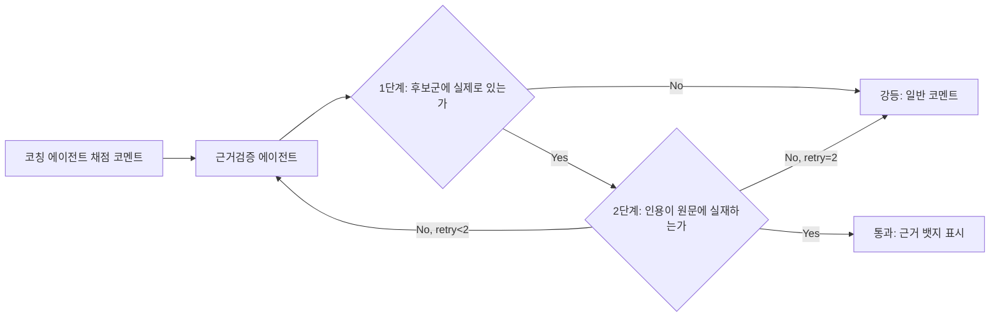

# 브리프코치 — RAG 설계서

> 작성일: 2026-08-19 | 목적: 근거검증(verify) 에이전트가 사용할 "화법 가이드 코퍼스" 설계

## 1. 왜 RAG가 필요한가

코칭 에이전트가 "이 답변은 STAR 구조가 부족합니다" 같은 채점 코멘트를 낼 때, 그 채점 기준이 실제 화법 가이드 문헌에 있는 근거인지 검증하지 않으면 LLM이 그럴듯하지만 틀린 기준을 지어낼 수 있다. 기존 크로스핏 프로젝트의 "근거 없는 확신을 팔지 않는다"는 설계 철학을 그대로 가져와, 여기서는 **의료적 위험 판정이 아니라 채점 신뢰성 검증**으로 리프레이밍한다.

## 2. 데이터셋 — 코퍼스 소스

| 구분 | 내용 | 목표 건수 |
|---|---|---|
| STAR 기법 가이드 | 채용/커리어 플랫폼의 STAR 기법 설명 아티클, 대학 커리어센터 자료 | 10~15건 |
| 두괄식/비즈니스 라이팅·스피킹 가이드 | 국내 커뮤니케이션 서적/아티클 요약, 컨설팅펌 공개 가이드 | 10~15건 |
| 기술 커뮤니케이션 가이드 | "개발자가 비개발자에게 설명하는 법" 류 블로그·아티클(§PRD 배경조사에서 확인된 자료) | 10~15건 |
| 자체 작성 체크리스트 | 팀이 직접 정리한 평가 기준 원문(두괄식 정의, STAR 4요소 정의, 3~5문장 권장 근거) | 5~10건 |

목표 총량: **30~50건** (기존 크로스핏 프로젝트의 안전문서 코퍼스 목표치와 동일한 규모 — 이 정도면 팀 2명이 12일 내에 직접 수집·정리 가능).

> **주의**: 원문을 그대로 대량 복제해 저장하지 않는다. 각 문서는 출처 URL과 함께 **요약·재정리한 본문**을 저장하고, 저작권이 있는 원문 전재는 피한다. 인용이 필요한 경우 짧은 발췌 + 출처 링크로 처리한다.

## 3. 청킹 전략

- 청크 크기: **300~500자** (기존 크로스핏 프로젝트의 `embedding` 검색 경로와 동일한 기준 재사용 — 검증된 값이라 새로 실험할 필요 없음).
- 분할 단위: 문서를 문단 단위로 우선 분할한 뒤, 300~500자를 넘는 문단만 문장 경계에서 추가 분할(문장 중간에서 자르지 않음).
- 각 청크는 `doc_id`, `chunk_text`, `embedding`, `token_count`를 저장하며, 원문 문서의 어느 부분인지 역추적 가능하도록 `chunk_index`를 둔다.

## 4. 임베딩 모델

**Azure OpenAI `text-embedding-3-small`** (1536차원)

- 이유: 코퍼스 규모가 30~50건 × 청크 수십 개 수준으로 작아 `-large` 대비 비용 이점이 무의미하지 않으면서도 한국어 성능은 충분. 기존 Azure OpenAI 리소스를 그대로 재사용 가능(신규 벤더 계약 불필요).
- 인덱스: pgvector **HNSW** (기존 크로스핏 프로젝트와 동일한 인덱스 방식).

## 5. 검색(리트리버) 설계

기존 크로스핏 프로젝트는 `tag_filter` / `llm_as_retriever` / `embedding` 3가지 검색 경로를 eval로 비교하는 구조였다. 이번 프로젝트는 **의도적으로 단순화**한다:

- **채택**: pgvector HNSW **top-k 임베딩 검색 단일 경로**만 사용한다.
- **이유**: 코퍼스가 훨씬 작고(30~50건 vs 원 프로젝트의 목표), 태그 체계를 별도로 설계·라벨링할 시간이 12일 일정에서 나오지 않는다. 3가지 경로를 eval로 비교하는 것 자체가 원 프로젝트에서도 아직 결론이 안 난 실험이었으므로, 이번엔 처음부터 가장 단순하고 검증된 방식(순수 임베딩 검색)으로 시작한다.
- **스트레치**: 시간이 남으면 `tag_filter`(카테고리별: STAR/두괄식/간결성 태그)를 보조 필터로 추가해 정확도를 높인다.

## 6. 가드레일 검증 체인 (기존 패턴 재사용)

1. **1단계 — 후보군 실재 확인**: 검색된 top-k 청크 중에 코칭 에이전트가 인용한 내용이 실제로 존재하는지 확인.
2. **2단계 — 인용 실재 확인**: 인용한 문장이 청크 원문에 실제로 있는 표현인지(의미 왜곡 없이) 확인.
3. 실패 시 최대 2회 재시도, 계속 실패하면 `verdict='degraded'`로 낮춰 "일반 주의" 톤 코멘트로 응답(근거 뱃지 미표시) — `guardrail_check` 테이블에 기록.

## 7. 구현 계획 (단계별)

| 순서 | 작업 | 산출물 |
|---|---|---|
| 1 | 코퍼스 수집 (§2 소스별 30~50건) | `speech_guide_doc` 시드 데이터 |
| 2 | 청킹 스크립트 작성 (300~500자, 문장 경계 보존) | `speech_guide_chunk` 생성 파이프라인 |
| 3 | 임베딩 생성·적재 (`text-embedding-3-small`) | pgvector HNSW 인덱스 |
| 4 | 검색 API 구현 (top-k 임베딩 검색) | `search_speech_guide(query, k)` 함수 |
| 5 | 근거검증 체인 구현 (LangGraph `verify_agent` 노드) | §6 플로우 |
| 6 | 간단 eval — 대표 채점 시나리오 10~15개로 강등률 측정 | 코퍼스 품질 점검 |

## 8. 미결 사항

- 코퍼스 저작권 검토(각 출처가 요약·재정리 형태로 사용 가능한지) — 팀 확인 필요.
- eval 케이스(§7 순서 6)는 시간이 부족하면 스킵 가능 — 최소한 수동으로 5개 시나리오는 점검 권장.
