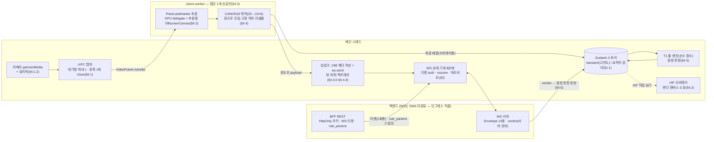
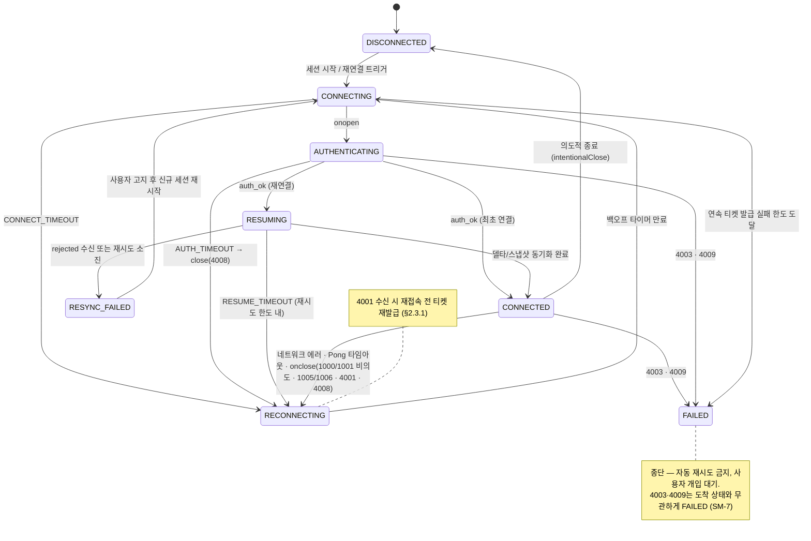
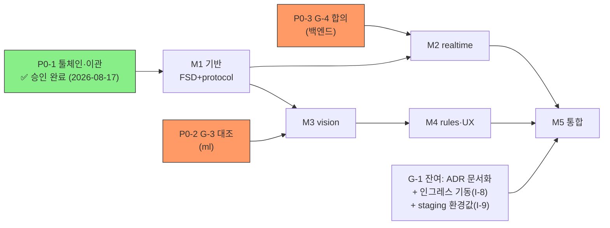

# 06. 실행 설계 플랜 (Master Plan) — 설계서 v2.1 → `frontend/` 적용

> **상태: ✅ 승인 — 실행 기준 문서** (2026-08-17 검토자 D-1~D-4 **전건 승인**) · 초판 2026-08-17 · 개정 v1.1(승인 반영·점검 개선 — 부록 C)
> 성격: [01](01_전제와_착수게이트.md)~[05](05_리스크_오픈이슈.md) 기획 문서를 **설계(design) 수준으로 격상·통합**한 단일 실행 플랜.
> 규범이 아니다 — 충돌 시 **설계서 v2.1 본문 > 부록 > 이 문서**. 수치는 「규격 이름」+절 번호로만 참조한다(패키지 버전만 예외).
> 이 문서의 상태 명칭·전이·구조는 설계서 v2.1 **원문 추출로 대조 확인**했다 (부록 A 팩트체크 기록).

---

## 차례

1. [한눈에 보기](#1-한눈에-보기)
2. [시스템 설계 개요 — 데이터 흐름과 소유권](#2-시스템-설계-개요)
3. [목표 디렉토리 설계 — 파일 수준 청사진](#3-목표-디렉토리-설계)
4. [WS 상태 기계 설계](#4-ws-상태-기계-설계)
5. [실행 단계 — Phase 0 + M1~M5](#5-실행-단계)
6. [의존성·크리티컬 패스](#6-의존성크리티컬-패스)
7. [검증 설계 요약](#7-검증-설계-요약)
8. [리스크 대응 설계](#8-리스크-대응-설계)
9. [검토 요청 — ✅ 전건 승인 이력](#9-검토-요청)
- [부록 A. 팩트체크 기록](#부록-a-팩트체크-기록) · [부록 B. 근거 문서](#부록-b-근거-문서) · [부록 C. 점검·개선 기록](#부록-c-점검개선-기록-v11--2026-08-17) · [개정 이력](#개정-이력)

---

## 1. 한눈에 보기

| 항목 | 내용 |
|---|---|
| **목표** | 설계서 v2.1의 규범 전체를 `frontend/`에 구현 — WS 실시간 코칭 파이프라인(카메라→Worker 추론→CANON19→업링크→서버 판정) 완성 |
| **현재 위치** | ✅ **Phase 0(툴체인)·M1(FSD+protocol) 완료 (2026-08-17)** — DoD 전건 통과(§7.1 골든/거부 · `tsc -b` 격리 · depcruise 0 위반 · 빌드). 다음 = 외부 요청 발신 + M2 준비([02 격차분석](02_격차분석.md) 대장 동기화됨) |
| **실행 단위** | **M1**(기반: FSD+프로토콜) → **M2**(WS 상태 기계) → **M3**(Worker 파이프라인) → **M4**(룰·가드·UX) → **M5**(통합·E2E) |
| **게이트** | M2 ← **G-4**(WS 카탈로그 합의) · M3 ← **G-3**(CANON19 대조) · M5 ← **G-1**(ADR+인그레스). M1·M4는 게이트 무의존 |
| **외부 의존 3건** | ① 툴체인·이관 **승인**(사용자) ② G-3 대조 요청(ml 담당) ③ G-4 합의(백엔드) — 셋 다 대기 시간이 크리티컬 패스 |
| **릴리스 기준** | §7.5 **P0 전건 = 내부 데모 게이트 · P0+P1 전건 = 릴리스 게이트** (부록 D.2) |
| **결정 상태** | [§9](#9-검토-요청) D-1~D-4 **전건 승인** (2026-08-17) — 내부 차단 요인 해소. 다음 단계 = Phase 0 실행(요청문 발신·툴체인 PR) → M1 |

---

## 2. 시스템 설계 개요

스레드·소유권 경계가 이 설계의 뼈대다. **P0 소유권 3원칙**: 렌더 캔버스는 메인 소유(§4.2) · 24B 헤더 작성과 `ws.send`는 메인 소유(§4.4.0) · Worker는 탭당 1개 싱글턴(§4.3).



- **원본 영상 프레임은 어떤 경우에도 네트워크로 전송하지 않는다**(§6.6, P0) — 서버로 가는 것은 CANON19 윈도우뿐.
- features 간 직접 import 금지 — vision 출력→rules 판정→realtime 전송의 **조립은 `pages/session`(+`app/`)이 담당**(§6.1.1·§4.5).

---

## 3. 목표 디렉토리 설계

FSD 구조(§6.1)의 **파일 수준 청사진**. 이관 매핑·import 규칙 상세는 [architecture/directory-structure.md](../architecture/directory-structure.md), 실행 순서는 [§5](#5-실행-단계). `M?`는 해당 파일이 만들어지는 마일스톤.

```
frontend/src/
├─ app/                          # M1 이관 — 진입점·프로바이더·라우팅·전역 스토어
│   ├─ main.tsx · App.tsx        #   (index.html 스크립트 경로 동반 수정)
│   └─ store/session-store.ts    # M4 — Zustand: 요약치 상태 + transient 구독 헬퍼 (§1.1)
├─ pages/                        # M4 — 화면 조립 (features 조립 지점 §4.5)
│   └─ movement-select/ · session/ · report/
├─ features/
│   ├─ realtime/                 # M2 — WS 전체 (§2·§3 송신측)
│   │   ├─ model/machine.ts          # 8상태 기계 · 단일 재연결 스케줄러 (§2.3)
│   │   ├─ model/heartbeat.ts        # ping/pong(nonce) — 「하트비트」
│   │   ├─ model/backoff.ts          # full jitter · attempt 리셋 — 「백오프」
│   │   ├─ model/ticket-auth.ts      # 티켓 auth · epoch/reauth — 「티켓·epoch」
│   │   ├─ model/resume.ts           # resume(lastRevision) · RESYNC_FAILED (§2.1)
│   │   ├─ model/uplink.ts           # 헤더 작성+send·링 버퍼·백프레셔 (§4.4.0·§4.4.4) ★메인 소유
│   │   ├─ model/lifecycle.ts        # hidden 유예·pagehide close·복귀 검증 (§5.1·§5.2) — M5
│   │   └─ testing/mock-websocket.ts # §7.2 시나리오용 (테스트 전용)
│   ├─ vision/                   # M3 — 캡처·Worker 래퍼·오버레이
│   │   ├─ api/worker-client.ts      # 싱글턴 획득/해제·헬스·재생성·CPU 폴백 (§4.3)
│   │   ├─ model/capture.ts          # rVFC 캡처 (rAF 폴백 금지 §4.1)
│   │   ├─ model/camera-watchdog.ts  # 「카메라 워치독」· track 이벤트 (§4.1.2)
│   │   └─ ui/overlay.tsx            # rAF 렌더 — 스토어 직접 읽기 (§4.2)
│   ├─ rules/                    # M4 — T1 룰 (§4.5)
│   │   ├─ model/engine.ts           # 순수 함수 — 「T1 판정 SLO」
│   │   ├─ model/params-loader.ts    # rule_params 3단 실패 경로 (§4.5.1)
│   │   └─ model/cue-scheduler.ts    # 오디오 큐 디바운스·우선순위 (§4.5.2)
│   └─ entry-guard/              # M4 — 진입 경로 가드 (§6.2.1)
│       ├─ lib/detect.ts             # 인앱/비지원 감지 (UA 상수는 shared/config)
│       └─ ui/GuardScreen.tsx        # 안내·탈출 3단계 (재시도 루프 금지)
├─ entities/                     # M1 골격 → M2~M4 충실화
│   └─ session/ · exercise-set/ · fault-code/   # 도메인 타입 (fault-code는 스키마 확정 전 unknown 경계 유지)
└─ shared/
    ├─ config/constants.ts       # M1 — §4 수치 규격 상수 전부 (규격 이름별 그룹 + 절 번호 주석) ★매직넘버 금지의 실현 지점
    ├─ config/browser.ts         # M4 — 인앱 UA 목록·지원 매트릭스 상수 (§6.2.1·§6.3)
    ├─ api/                      # M1 이관 → M2 개선 — credentials:'include'·타임아웃·401 경로 (§2.2.2) · 응답 unknown 유지
    │   └─ tickets.ts · rule-params.ts (신설)
    ├─ ui/ · lib/                # M1 이관 — wake-lock.ts(§5.3, M4) · telemetry.ts(§6.5, M5) · audio-unlock.ts(M4)
    ├─ protocol/                 # M1 ★DOM 비의존 (tsconfig.worker) — §3 전체의 단일 소스
    │   ├─ envelope.ts               # EnvelopeType 14종·Envelope 필드 (§3.1) ← G-4 합의 반영 지점
    │   ├─ frame-header.ts           # 24B 헤더 인코더/디코더 (§3.2·§3.3)
    │   ├─ receive-guard.ts          # 수신 가드 — 폐기 사유 enum·카운터 훅, 예외 불방출 (§3.5)
    │   ├─ canon19.ts                # 19관절 매핑 상수·채널 타입 (§4.4.1~2) ← G-3 확정 반영 지점
    │   └─ golden-vectors.ts         # 골든/거부 바이트 벡터 (§7.1)
    └─ workers/                  # M3 ★DOM 비의존 — import는 shared/protocol만
        ├─ vision.worker.ts          # 추론 루프·CANON19 축약·윈도우 조립 (§4.2~§4.4)
        ├─ window-assembler.ts       # 고정 격자 리샘플 순수 로직 (§4.4.3) — 단위 테스트 1급 대상
        └─ messages.ts               # 메인↔Worker 메시지 계약 (transferable 규약)
```

**경계 강제(§6.1.1)** — dependency-cruiser 규칙 4종(`no-cross-feature` · `no-upward-import` · `no-slice-internals` · `worker-no-dom`)을 M1에서 설정, CI 반영은 담당자 요청([05](05_리스크_오픈이슈.md) I-2). `shared/protocol`·`shared/workers`의 DOM 비의존은 **tsconfig.worker Project References가 컴파일 타임에 강제**한다 — 이것이 툴체인 정비(§5 Phase 0)가 선행되어야 하는 이유다.

---

## 4. WS 상태 기계 설계

상태 명칭·전이는 **설계서 §2.3 원문 그대로**다 (2026-08-17 원문 추출 대조 — 부록 A). 타이머·한도 값은 「핸드셰이크 타임아웃」·「백오프」·「티켓·epoch」·「종료 코드」 규격을 `shared/config/constants.ts`에서 참조한다.



**설계 결정 7건** (전부 규범 직결):

| # | 결정 | 근거 |
|---|---|---|
| SM-1 | 재연결 스케줄링은 `machine.ts` **단일 경로**만. RECONNECTING 중 도착하는 `onclose`는 no-op (이중 스케줄 방지) | §2.3.2 규칙 ③ (P0) |
| SM-2 | `intentionalClose`는 CONNECTING 진입 시 리셋 · 1000뿐 아니라 **1005/1006 분기에서도 확인** · 의도적 close 전 경로에서 설정 | §2.3.2 규칙 ①② (P0) |
| SM-3 | RECONNECTING 진입 시 **정리용 `close(1000)`에도 플래그를 설정**한 뒤 백오프 — 원문 §2.3 표의 동작 그대로 | §2.3 |
| SM-4 | FAILED 종단은 **연속 티켓 실패 한도** 도달 시에만 — 네트워크성 실패 카운터와 혼동 금지(그쪽은 무제한+수동 버튼) | 「티켓·epoch」·「백오프」 |
| SM-5 | `binaryType = 'arraybuffer'`는 CONNECTING의 `new WebSocket()` 직후 즉시 설정 (원문 §2.3 CONNECTING 동작에 포함) | §2.3 · §3.5 |
| SM-6 | bfcache 복원·online 복귀는 attempt 리셋 + 즉시 재연결로 **백오프 경로를 우회**하는 별도 진입 — 상태 기계에 고속 경로 입력을 둔다 | §5.2 · 「라이프사이클 타이머」 |
| SM-7 | 종료 코드 분기표는 **상태 무관 단일 `onclose` 핸들러**에서 적용 — 4003·4009는 어느 상태에서 도착해도 FAILED, 4001은 티켓 재발급 후 재접속. 단 RECONNECTING 중 도착분은 no-op(SM-1) | §2.3.1 · 「종료 코드」 |

검증은 MockWebSocket 시나리오 S1~S9([04](04_검증_수용기준.md) §2)가 전이 전건을 커버한다 — S4가 SM-2, S7이 SM-4, S8이 SM-6의 회귀 방어다.

---

## 5. 실행 단계

### Phase 0 — 착수 조건 확보 (지금, 병행)

| # | 작업 | 주체 | 산출물 | 상태 (2026-08-17) |
|---|---|---|---|---|
| P0-1 | **툴체인 정비** → 단일 PR: TS `~6.0.3` 다운그레이드 · tsconfig 3분할(Project References) · `build.target ['chrome111','edge111']` · `-E` 설치 4건(zustand@5.0.15 · tasks-vision@1.0.1 · depcruise) | 프론트 | 툴체인 PR ([03](03_적용로드맵.md) §1 상세) | ✅ **완료 (2026-08-17)** — 버전·레인지 보존 검증 통과 |
| P0-2 | **G-3 대조 요청 발신** — AI Hub 라벨 ↔ CANON19 매핑표 | ml 담당 | 매핑 확정 회신 → `canon19.ts` 반영 | 📤 초안 완료([07](07_외부요청문.md) R-A) — **팀 채널 발신 대기** |
| P0-3 | **G-4 카탈로그 합의** — §3.1 EnvelopeType 14종·§4.4 데이터율로 구계약(wave0) 대체 확정 | 백엔드 | 합의 기록 → `envelope.ts` 반영, [05](05_리스크_오픈이슈.md) I-1 해소 표기 | 📤 초안 완료([07](07_외부요청문.md) R-B) — 발신 대기 |
| P0-4 | CI 정비 요청 전달 (Node 22↑·OIDC·depcruise 단계 — 설계서 영향 절 명기) | CI 담당 | [05](05_리스크_오픈이슈.md) I-2 요청 기록 | 📤 초안 완료([07](07_외부요청문.md) R-C) — 발신 대기 |

### M1 — 기반 (게이트 무의존 · P0-1 승인만 선행) — ✅ **완료 (2026-08-17)**

**순서**: ① FSD 골격+tsconfig 재편(같은 PR) → ② 기존 파일 `git mv` 이관(한 폴더씩, 동작 변경 금지) → ③ `shared/protocol` 구현(envelope→frame-header→receive-guard→golden-vectors) → ④ depcruise 규칙 로컬 통과.
**DoD 달성 기록**: §7.1 라운드트립·거부 벡터 전건 통과(테스트 23건) + `tsc -b` 통과 + depcruise 0 위반 + vite build 성공. **게이트 실효성 음성 테스트**: protocol 내 DOM 사용 → TS2304 실패 확인 · 경계 위반 파일 → depcruise 2규칙 검출 확인 (부재가 아니라 검출로 통과 입증).

### M2 — features/realtime (선행: G-4) — 🟡 준비 완료 (2026-08-17), 본구현은 G-4 대기

**준비 완료분**: 8상태 명칭 타입(`model/states.ts`, §2.3 원문 그대로) · MockWebSocket(close 코드·지연·무응답 주입, **도구 자체 테스트 9건으로 신뢰성 검증** — CONNECTING send 예외·close 코드 검증·onerror→onclose 순서 등 브라우저 동작 모사) · §7.2 S1~S9 시나리오 하네스(`machine.scenarios.test.ts`, todo 고정).
**본구현 순서(G-4 합의 후)**: machine.ts(8상태·SM-1~7) → ticket-auth → resume → heartbeat → backoff → uplink 골격 → `shared/api` 개선(credentials·타임아웃·401) → S1~S9 전건 채움.
**DoD**: §7.2 전 시나리오 통과.

### M3 — features/vision + shared/workers (선행: G-3) — 🟡 M3-0 완료 (2026-08-17)

**M3-0 완료분**: WASM 6파일(`@mediapipe/tasks-vision@1.0.1` 패키지 복사 — FilesetResolver의 런타임 SIMD 선택 때문에 전 파일 필요) + pose_landmarker Lite·Full(공식 스토리지) → `public/mediapipe/` self-hosting, SHA-256 기준선·갱신 규칙은 `public/mediapipe/README.md`, 경로 상수는 `shared/config/mediapipe.ts` (CDN 하드코딩 금지 P0).
**M3 준비 완료분 (2026-08-17)**: **window-assembler**(`shared/workers/` — §4.4.3 고정 격자 리샘플·선형 보간/최근접 홀드·INTERPOLATED·비율 하한 드롭·스트라이드 수집기. **채널 무지 설계라 G-3 매핑과 독립** — 저프레임 12fps/8fps 합성 입력 등 테스트 13건, §7.5 P0 윈도우 계약 케이스 선반영).
**잔여 순서(G-3 확정 후)**: worker-client 싱글턴·헬스 → capture(rVFC) → vision.worker(추론→CANON19→window-assembler) → uplink 실연결(t_offset_ms 바인딩) → camera-watchdog.
**DoD**: §7.5 프레임 정확 1회 close·카메라 스톨·윈도우 계약(저프레임 합성 입력) 테스트 통과.

### M4 — rules · entry-guard · UX (게이트 무의존 — M3와 부분 병행 가능) — 🟡 선행분 완료 (2026-08-17)

**선행 완료분**: entry-guard 감지·판정·탈출 3단계 URL(`lib/detect.ts` — UA 목록은 `shared/config/browser.ts` 단일 출처, **웨일 브라우저 오차단 방지 회귀 테스트 포함**, iOS는 탈출 유도 대신 비지원 안내) · Wake Lock 관리자(`shared/lib/wake-lock.ts` — 제스처 획득·release 단일 핸들러·hidden 중 request 차단·auto/수동 구분 계측) · **오디오 언락**(`shared/lib/audio-unlock.ts` — 제스처 resume·running 아니면 세션 차단 §4.5.2) · **큐 스케줄러**(`features/rules/model/cue-scheduler.ts` — 「모델·오디오」 디바운스·안전>폼>격려 선점) · **Zustand 스토어**(`app/store/session-store.ts` — §1.1 요약치 10Hz 스로틀 / transient 무알림 가변 슬롯 2층 분리, transient 쓰기의 무알림을 회귀 테스트로 고정).
**시각 UI 완료 (2026-08-17 — v1.5)**: 디자인 토큰(`shared/ui/tokens.css` — CSS 변수·라이트/다크 자동·reduced-motion) · 공용 컴포넌트(Button·Banner 4변형·Progress·인라인 SVG 아이콘 7종) · **GuardScreen**(§6.2.1 3분기 — 탈출 3단계·URL 복사 항상 병행·iOS 탈출 유도 금지를 테스트로 고정) · **pages 3종 조립**(선택→세션→리포트 선형 페이즈 — 라우터 도입은 의존성 승인 대상이라 보류) · **app 조립**(진입 판정 → 세션 제스처에서 오디오 언락+Wake Lock 동일 핸들러 §4.5.2·§5.3 → visible/pageshow 재획득·pagehide 해제 배선). 스토어 값은 app→pages **props 하향 주입** (pages의 app import는 FSD 위반 — depcruise가 차단).
**잔여**: engine·params-loader — **rule_params 스키마 확정 대기**(타입을 지어내지 않는다) · 큐 자막/coachingNotice 실배선(params-loader·오디오 스프라이트 자산 필요) · 실기 검증(§7.5).
**DoD**: §7.5 Wake Lock·진입 경로 + §7.3 룰 회귀(G-3 후 픽스처).

### M5 — 통합 (선행: G-1 잔여 + 인그레스 기동 + staging 환경값)

**순서**: lifecycle 전이 전체 배선 → telemetry 9종 → staticwebapp.config.json → Playwright 스모크 → 실기 매트릭스(D.3)·P1.
**DoD**: §7.4 스모크 + §7.5 잔여 전건 → **P0 전건 = 내부 데모 · P0+P1 = 릴리스**.

---

## 6. 의존성·크리티컬 패스



- 주황 = **잔여 외부 의존**(G-3·G-4·G-1) — 응답 대기가 유일한 지연 요인이므로 즉시 발신한다. 초록 = 승인 완료(내부 차단 해소).
- 병행 가능: M2 준비(Mock·시나리오)와 M3-0(WASM 자산)은 게이트 무관 · M4 룰 엔진 순수 함수는 픽스처만 있으면 M3과 병행.
- M5 실질 차단은 인프라 측(I-8 인그레스 무응답) — 프론트 설계 변경은 불요, `az` 재실측으로 기동 여부를 M5 전 확인한다.

---

## 7. 검증 설계 요약

상세는 [04_검증_수용기준.md](04_검증_수용기준.md) — 여기는 **자산 → 마일스톤 매핑**만.

| 테스트 자산 | 위치 | 만드는 시점 | 방어 대상 |
|---|---|---|---|
| 골든/거부 바이트 벡터 | `shared/protocol/golden-vectors.ts` | M1 (코덱과 동시) | 헤더 코덱 회귀 — **코덱 출력으로 골든 갱신 금지**(순환 참조) |
| MockWebSocket + S1~S9 | `features/realtime/testing/` | M2 준비(게이트 무관) | 상태 기계 전이 전건 · intentionalClose |
| window-assembler 단위 테스트 | `shared/workers/` 옆 | M3 | 고정 격자 리샘플·INTERPOLATED·저프레임 경로 |
| 랜드마크 픽스처(룰 회귀) | `features/rules/` 옆 | **G-3 확정 후** (선제작 금지) | 룰 판정 결정론 |
| rule_params 주입 테스트 | `features/rules/` 옆 | M4 (스키마 확정 후) | 3단 실패 경로·조용한 비활성화 금지 |
| Playwright 합성 세션 | e2e | M5 | 프레임 드롭·롱태스크 SLO |

수용 기준 전체 추적표(§7.5 P0 11건 + P1 1건)는 [04 문서 §6](04_검증_수용기준.md) — 각 항목이 위 자산 중 무엇으로 검증되는지 매핑되어 있다.

---

## 8. 리스크 대응 설계

등록부 전체는 [05_리스크_오픈이슈.md](05_리스크_오픈이슈.md). 여기는 **이 플랜의 진행을 실제로 위협하는 상위 4건**과 설계상 대응만.

| 리스크 | 이 플랜에서의 대응 |
|---|---|
| G-3·G-4 응답 지연 (외부) | Phase 0에서 **즉시 발신** + M1·M2 준비·M3-0 자산화로 대기 시간을 흡수. `canon19.ts`·`envelope.ts`를 **반영 지점 단일 파일**로 설계해 확정 시 수정 반경 최소화 |
| 인그레스 미기동 (R-6/I-8) | M5 전 `az` 재실측. 프론트는 하트비트 규격이 인프라 기본 타임아웃보다 짧게 설계돼 있어 코드 변경 불요 — 기동 확인만 |
| wave0 구계약 재생산 (I-1) | M1 이관 시 `src/ws` 주석·README의 구계약 기술을 **이관과 동시에 §3.1 기준으로 갱신** — 참조 원천 제거 |
| TS 7.x 역행 PR (A-1) | `~6.0.3` 고정 근거를 `package.json` 인접 문서·PR 설명에 명기, 격차 대장에 "7.x 복귀 금지" 유지 |

---

## 9. 검토 요청

> ✅ **2026-08-17 검토자(프론트 담당) 회신: D-1~D-4 전건 승인.** 아래 표는 승인 이력으로 보존한다.
> 승인에 따른 실행 순서: ① 외부 요청문 3건 초안·발신(P0-2~P0-4 — 대기 시간이 크리티컬 패스이므로 최우선) → ② 툴체인 PR(P0-1) → ③ M1 착수. 이후 진행 보고는 이 문서(06) 기준으로 통일한다(D-4).

| # | 결정 요청 | 승인 시 즉시 실행되는 것 | 미결 시 영향 |
|---|---|---|---|
| **D-1** | 툴체인 정비 PR 승인 (P0-1: TS 다운그레이드·tsconfig 3분할·build.target·의존성 4건 — [03 §1](03_적용로드맵.md) 명령 단위 상세) | M1-1 착수 → M1 전체 진행 가능 | **모든 마일스톤 지연** — 유일한 내부 차단 요인 |
| **D-2** | FSD 이관 착수 승인 (git mv·골격 생성 — D-1과 같은 흐름, 별도 확인용) | M1-2 착수 | M1 불완전 — protocol 배치 위치 부재 |
| **D-3** | 외부 요청 3건 발신 승인 — G-3(ml)·G-4(백엔드)·CI 정비(담당자). **요청문 초안은 프론트가 작성해 전달 가능** | P0-2~P0-4 발신 | M2·M3 착수 시점이 응답 대기만큼 밀림 |
| **D-4** | 이 플랜 문서 구조 승인 — 06(통합 플랜)을 실행 기준으로 삼고 01~05는 상세 대장으로 유지 | 색인 확정 · 이후 진행 보고를 06 기준으로 통일 | 문서 이원화 지속 |

향후 신규 결정 항목이 생기면 D-5부터 이 표에 추가하고, 회신은 항목 번호로 받는다.

---

## 부록 A. 팩트체크 기록

| 검증 항목 | 방법 | 결과 (2026-08-17, 당일 3차) |
|---|---|---|
| WS 8상태 명칭·전이·동작 | 설계서 v2.1 docx **원문 텍스트 추출** 후 §2.3 표 대조 | §4의 상태도·SM-1~6이 원문과 일치 확인 (DISCONNECTED·CONNECTING·AUTHENTICATING·RESUMING·CONNECTED·RECONNECTING·RESYNC_FAILED·FAILED) |
| typescript 6.x 고정 수단 | `npm view typescript@6` / `dist-tags` | 6.x 최종 = **6.0.3** · latest = 7.0.2 · 6.x dist-tag 없음 → `~6.0.3`이 유일한 고정 수단 (당일 3회 일치) |
| 확정 버전 실재 | `npm view <pkg> version` | zustand **5.0.15** · @mediapipe/tasks-vision **1.0.1** · dependency-cruiser **18.2.0** — §1 확정값 전건 존재 |
| 현재 코드 상태 | `frontend/src` 전수 목록 | [02 격차분석](02_격차분석.md) 기재와 일치 (ws/api 뼈대 + pose/rules/ui README-only) |

브라우저 API(rVFC·Wake Lock·bfcache·LoAF)·npm 상세 팩트체크 원자료는 로컬 준비 기획(07 문서)에 있다 — 팀 문서 채널로 요청.

## 부록 B. 근거 문서

- **규범**: 프론트엔드 설계서 v2.1 (팀 문서 채널) — 절 색인은 로컬 `.claude/reference/README.md`
- **FSD 공식**: [Layers](https://feature-sliced.design/docs/reference/layers) · [Slices/Segments](https://feature-sliced.design/docs/reference/slices-segments)
- **dependency-cruiser**: [GitHub](https://github.com/sverweij/dependency-cruiser) (규칙 4종 설정 근거)
- **TypeScript Project References**: [공식 핸드북](https://www.typescriptlang.org/docs/handbook/project-references.html) (tsconfig 3분할·`tsc -b` 근거)
- **Vite build.target**: [공식 문서](https://vite.dev/config/build-options#build-target) — 기본값 `'baseline-widely-available'`은 Firefox·Safari 포함 → **명시 배열 지정이 §6.3 SSOT 준수의 유일한 수단** (2026-08-17 원문 재확인)
- **MediaPipe Pose Landmarker (Web)**: [공식 가이드](https://developers.google.com/edge/mediapipe/solutions/vision/pose_landmarker/web_js) (self-hosting·delegate 근거 — 구 `ai.google.dev` 경로는 301 이전됨, 부록 C)
- **MDN**: [rVFC](https://developer.mozilla.org/docs/Web/API/HTMLVideoElement/requestVideoFrameCallback) · [Screen Wake Lock](https://developer.mozilla.org/docs/Web/API/Screen_Wake_Lock_API) · [WebSocket close codes](https://developer.mozilla.org/docs/Web/API/CloseEvent/code)

## 부록 C. 점검·개선 기록 (v1.1 — 2026-08-17)

D-1~D-4 승인 직후 이 문서를 자체 점검한 결과와 조치. **재발 방지**: 링크 유효성·다이어그램 정합은 마일스톤 경계 재점검 항목에 포함한다(하단 개정 이력에 점검 일자 기록).

| # | 발견 (분류) | 근본 원인 | 조치 |
|---|---|---|---|
| C-1 | §4 상태도가 종료 코드 4001·4003/4009의 **CONNECTED 상태 도착 경로를 누락** (설계 결함) | 상태도를 §2.3 상태 표 기준으로만 작성하고 §2.3.1 **종료 코드 분기표와 교차 대조하지 않음** | CONNECTED→FAILED(4003·4009)·onclose 라벨 보강 + **SM-7**(상태 무관 단일 onclose 핸들러) 신설 — 구현 시 누락됐을 결함을 설계 단계에서 차단 |
| C-2 | 부록 B MediaPipe 링크가 `ai.google.dev` → `developers.google.com` **301 이전** (링크 부패) | 최초 팩트체크 후 공식 문서 도메인 개편 | 실제 fetch로 이전 확인 후 신 URL로 교체. 링크는 기록 시점이 아니라 **점검 시점 유효성**으로 관리 |
| C-3 | §3 디렉토리 트리 분기 기호 오기 2건 — pages·entities 마지막 항목이 `├─` (표기) | 수기 트리 작성 시 검산 생략 | `└─`로 정정 |
| C-4 | 헤더·§1·§5·§6·§9가 "검토 대기" 상태로 잔존 (문서 부패) | 승인 이벤트와 문서 갱신의 동기화 규칙이 문서 자신에는 미적용 | 승인 이력·상태 열·실행 순서 반영. 이후 상태 변동은 **변동 시점에 이 문서를 함께 갱신**(운영 원칙 4 준용) |
| C-5 | Vite build.target 근거가 링크만 있고 **기본값이 왜 위험한지 미기재** (가독성) | — | 기본값 `'baseline-widely-available'`(Firefox·Safari 포함) 명기 — 명시 배열의 필요성이 문서만으로 자명해짐 |

## 개정 이력

| 판 | 일자 | 내용 |
|---|---|---|
| v1.0 | 2026-08-17 | 초판 — 01~05 격상·통합, 검토 요청 D-1~D-4 |
| v1.1 | 2026-08-17 | D-1~D-4 전건 승인 반영 + 자체 점검 조치 C-1~C-5 (상태도 종료 코드 보강 · 링크 교정 · 상태 동기화) |
| v1.2 | 2026-08-17 | **Phase 0(P0-1)·M1 구현 완료 반영** — 툴체인 정비·FSD 이관·shared/protocol·depcruise 가동, DoD 전건 통과 + 게이트 음성 테스트 입증. 외부 요청문 3건 초안([07](07_외부요청문.md)) |
| v1.3 | 2026-08-17 | **M2 준비·M3-0·M4 선행분 완료** — MockWebSocket+S1~S9 하네스 · WASM/모델 self-hosting(+해시 기준선) · entry-guard 감지·Wake Lock 관리자. 수정 2건: wake-lock 상태 중복 통지(멱등화) · oxlint 자산 오검사(ignore) |
| v1.4 | 2026-08-17 | **게이트 무관 잔여분 완료** — window-assembler(§4.4.3, G-3 독립) · 오디오 언락(§4.5.2) · 큐 스케줄러 · Zustand 스토어 2층(§1.1) · staticwebapp 템플릿(A-6 🟡, `__API_HOST__` 치환만 잔여). 이후 잔여 작업은 전부 외부 확정 대기(G-3·G-4·rule_params 스키마·환경값) 또는 M4 시각 디자인 |
| v1.5 | 2026-08-17 | **M4 시각 UI 완료** — 디자인 토큰·공용 컴포넌트·GuardScreen·pages 3종·app 조립(제스처 배선·§5.3 라이프사이클 리스너). 이제 내부 잔여 없음 — 전 잔여가 외부 확정 대기 |
