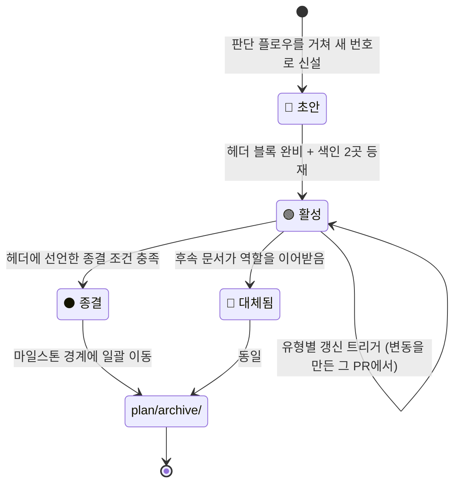
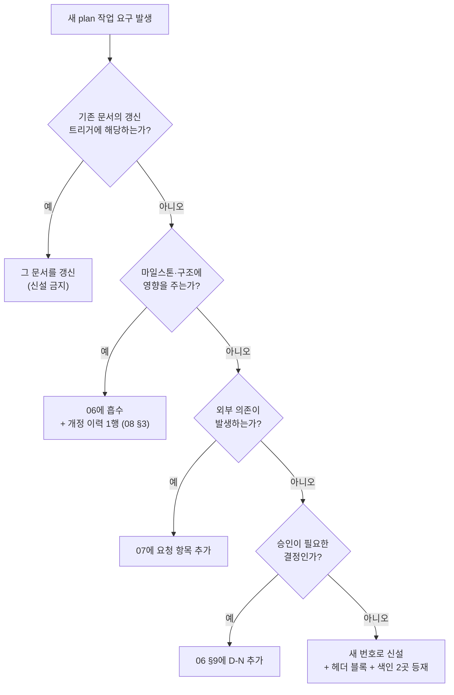

# frontend/docs/plan — 설계서 v2.1 적용 기획·실행 문서군

**프론트엔드 설계서 v2.1**(실측 반영판, 2026-08-17 확정)의 규범을 `frontend/` 코드베이스에 적용하기 위한
**팀 공유 실행 문서군**이다. 규범이 아니라 실행 계획이다 — 충돌 시 항상 **설계서 v2.1 본문 > 부록 > 이 문서** 순으로 우선한다.

- 이 폴더는 커밋되는 **팀 공유 문서**다 (`frontend/docs/` 예외 규칙 — 상위 [README](../README.md)). 시크릿·개인 메모 금지.
- **수치 규격을 여기 다시 적지 않는다** — 타이머·프로토콜 상수는 「규격 이름」과 설계서 절 번호로만 참조한다.
  (패키지 버전은 설계서 §1의 스택 확정값이므로 예외적으로 명기한다.)

## 폴더 아키텍처 — 문서 유형과 역할

문서는 4유형으로 나뉜다. **유형이 갱신 규칙과 종결 조건을 결정한다.**

| 유형 | 문서 | 성격 | 갱신 트리거 | 종결 조건(유형 기준) |
|---|---|---|---|---|
| **기준** (정적) | [01](01_전제와_착수게이트.md) | 확정 전제·게이트 정의 — 뒤집으려면 설계서 개정 경유 | 게이트 판정 변동 시만 | 게이트 전건 해소 |
| **대장** (추적형) | [02](02_격차분석.md) · [05](05_리스크_오픈이슈.md) · [07](07_외부요청문.md) | 행 단위 상태 추적 — 해소 시 ✅+날짜, 삭제하지 않음(이력 보존) | 해당 행의 상태가 바뀐 PR/시점 | 전 행 해소 또는 후속 대장 이관 |
| **플랜** (준정적) | [03](03_적용로드맵.md) · [04](04_검증_수용기준.md) | 절차·기준 — 실행 중 크게 바뀌지 않음 | 마일스톤 경계 재대조 | 대상 마일스톤 전건 완료 |
| **실행 기준** (단일 진실) | **[06](06_실행설계플랜.md)** | 승인된 실행 기준 + 진행 현황 + 점검 기록(부록 C) + 개정 이력 | **모든 유의미한 상태 변동** — 진행 보고는 이 문서 기준 | **없음** — 프로젝트 종료 시 동결 |
| **운영** | [08](08_플랜모드_운영.md) | Claude Code 플랜 모드·서브에이전트와 이 폴더의 연동 규칙 | 도구 동작 변경 시 | 해당 도구·프로세스 폐지 시 |

각 문서의 **구체적** 종결 조건은 그 문서 헤더 블록에 선언되어 있다 — 판단 근거를 색인이 아니라 문서 자신이 갖는다.

## 문서 헤더 표준 블록 (번호 문서 전건 필수)

`NN_제목.md` 형태의 문서에 예외 없이 붙인다 (이 README와 `tools/`는 색인·도구라 대상이 아니다).
제목(`# …`) 바로 다음 줄에 인용 블록 1줄로 둔다. 필드 4종·순서 고정:

```markdown
> **유형** 대장 · **문서 상태** 🟢 활성 · **최종 갱신** 2026-08-18 · **종결 조건** 전 행 ✅ 해소 또는 후속 대장 이관
```

- **YAML front matter를 쓰지 않는다** — GitHub 저장소 뷰의 front matter 렌더링은 문맥에 따라 표로 변환되거나 원문 노출되어 일관되지 않는다. 인용 블록은 어느 뷰어에서도 같게 보인다.
- **최종 갱신**은 본문을 고친 **그 커밋에서 함께** 바꾼다. 손으로 관리하는 값이므로 부패할 수 있어 → 점검 도구가 git 최종 수정일과 대조해 검출한다([점검 도구](#점검-도구)).
- **종결 조건**은 "무엇이 참이 되면 이 문서의 역할이 끝나는가"를 검증 가능한 문장으로 쓴다. 비워두지 않는다.

### 두 가지 상태를 혼동하지 않는다

| 구분 | 어휘 | 붙는 곳 |
|---|---|---|
| **문서 상태** (수명주기) | `📝 초안` · `🟢 활성` · `⚫ 종결` · `🔁 대체됨` | 헤더 블록 · README 색인 |
| **항목 상태** (내용의 진행도) | `✅ 완료` · `🟡 부분/준비` · `🔴 차단(게이트)` · `⬜ 대기` · `📤 발신 대기` | 문서 안의 표 행 (게이트·격차·이슈·요청) |

이모지 집합을 겹치지 않게 나눈 이유다 — **활성 문서 안에 완료된 행이 있는 것이 정상**이고, 그 반대(종결 문서 안의 미해소 행)는 종결 절차 위반이다.

## 수명주기 상태 기계



- **종결과 아카이브는 별개 단계다.** 종결은 상태 선언(경로 불변), 아카이브는 배치 이동(경로 변경). 종결 즉시 옮기지 않는 이유는 링크 안정성 때문이다 — 아래 절차 참조.
- **삭제하지 않는다.** 역할이 끝난 문서는 이력이다 (MADR·PEP 관행 — 결정을 뒤집을 때 기존 기록을 편집하지 않고 새 기록으로 대체하며 원본은 남긴다).
- **번호는 소진된다** — 아카이브로 옮긴 뒤에도 그 번호를 재사용하지 않는다.

## 종결 처리 체크리스트

종결 조건이 충족되었다고 판단하면 **아래 순서 그대로** 수행하고 한 커밋으로 묶는다.

1. **판정** — 헤더의 종결 조건이 실제로 충족됐는지 문서 본문으로 확인한다. 미해소 행이 하나라도 남아 있으면 종결하지 않는다.
2. **잔여 흡수** — 결론·잔여 사항을 [06](06_실행설계플랜.md)(또는 역할을 이어받는 후속 문서)에 옮기고, **어디로 갔는지 링크를 남긴다.** 흡수 없이 종결하면 정보가 사라진다.
3. **헤더 갱신** — 문서 상태를 `⚫ 종결 (날짜)` 또는 `🔁 대체됨 → [후속 문서](링크)`로 바꾸고, **종결 사유 1줄**을 같은 줄에 붙인다.
4. **색인 이동** — 이 README의 색인에서 해당 행을 **활성 표 → 종결·아카이브 표로 옮긴다.** 상위 [docs/README](../README.md) 표도 같은 PR에서 갱신한다.
5. **링크 점검** — 다른 문서에서 이 문서로 향하는 링크는 **아카이브 이동 전까지 경로가 그대로**이므로 수정 대상이 아니다. 점검 도구로 깨진 링크 0건만 확인한다.
6. **커밋** — 종결 처리는 내용 변경이므로 아카이브 이동과 **같은 커밋에 넣지 않는다**(다음 절 이유).

## 아카이브 이동 절차 (마일스톤 경계, 일괄)

종결·대체됨 문서가 쌓이면 **마일스톤 경계에서만** 한 번에 옮긴다. 상시 이동은 링크를 계속 흔들기 때문이다.

```bash
# 1) 이동만 — 내용 변경을 절대 섞지 않는다
git mv frontend/docs/plan/0N_문서.md frontend/docs/plan/archive/
git commit -m "docs(frontend): plan 0N 아카이브 이동 (이동만)"

# 2) 링크 수정 — 별도 커밋
#    ① 옮긴 문서 안의 상대 링크에 ../ 접두   ② 다른 문서에서 이 문서로 향하는 링크에 archive/ 접두
#    ③ 이 README·상위 docs/README 색인 경로
git commit -m "docs(frontend): plan 아카이브 이동에 따른 링크 정합"

# 이력 추적 (이동 후)
git log --follow frontend/docs/plan/archive/0N_문서.md
```

**왜 이동과 내용 변경을 분리하는가** — git은 rename을 저장하지 않고 **내용 유사도(기본 임계 50%)로 감지**한다. 이동과 대폭 수정을 한 커밋에 섞으면 유사도가 떨어져 rename으로 인식되지 않고 `git log --follow`가 끊긴다. `--follow`는 한 번에 한 파일만 추적하며 머지 커밋을 건너뛰는 한계도 있으므로, 감지 확률을 낮추는 커밋을 만들지 않는 것이 유일한 방어다.

**왜 링크를 반드시 손보는가** — GitHub은 상대 링크를 **현재 파일 위치 기준**으로 해석하고 파일 이동 시 자동 보정하지 않는다. 옮긴 순간 양방향 링크가 모두 404가 된다.

**`archive/` 폴더는 첫 아카이브 대상이 생겼을 때 만든다** — git은 빈 디렉토리를 추적하지 않아 미리 만들어도 커밋되지 않는다(자리표시자 파일을 두는 편법도 쓰지 않는다).

## 신규 plan 작업 판단 플로우

새 문서를 만들기 전에 반드시 통과시킨다. **문서 증식이 아니라 갱신이 기본값이다.**



## 관리 규칙

1. **신설**: 위 판단 플로우를 통과한 것만. 다음 번호(`09_…`)로 만들고 이 README 색인과 상위 [docs/README](../README.md) 표에 **같은 PR에서** 등재한다. 번호는 재사용하지 않는다.
2. **갱신**: 유형별 트리거를 따른다. 게이트·이슈·격차의 상태 변동은 **변동을 만든 그 PR에서** 해당 문서와 헤더의 최종 갱신일을 함께 고친다 (문서 부패 방지 — 상위 README 3원칙).
3. **점검**: 마일스톤 경계마다 06 부록 C 방식(발견·근본 원인·조치)으로 자체 감사를 남긴다. 점검 도구 실행 결과(링크·헤더·색인 정합)를 근거로 첨부한다.
4. **종결·아카이브**: 위 [종결 처리 체크리스트](#종결-처리-체크리스트)와 [아카이브 이동 절차](#아카이브-이동-절차-마일스톤-경계-일괄)를 따른다. 삭제는 어떤 경우에도 하지 않는다.
5. **로컬 원자료와의 동기**: 게이트·이슈 상태가 바뀌면 로컬 준비 기획(docs/plan — gitignore)과 이 폴더를 **양쪽 함께** 갱신한다. 두 곳이 어긋나면 로컬이 아니라 **설계서 v2.1**로 판정한다.
6. **Claude Code 연동**: 플랜 세션의 `@` 참조 대상은 **활성 문서만**이다. 아카이브 문서는 현행 기준이 아니므로 참조하지 않는다 ([08](08_플랜모드_운영.md) §2·§3).

## 문서 색인

### 활성

| 문서 | 유형 | 내용 | 진행 현황 |
|---|---|---|---|
| [01_전제와_착수게이트.md](01_전제와_착수게이트.md) | 기준 | 확정 전제 3건 · 게이트 G-1~G-4 판정 · 사전 준비물(DoR) | G-1 🟢 · G-2 🔴 확정 · G-3/G-4 🔴 요청 대기 |
| [02_격차분석.md](02_격차분석.md) | 대장 | 현재 코드 ↔ 설계서 격차 전수 대장 | A축 ✅ · B축 🟡 · C축 요청 중 |
| [03_적용로드맵.md](03_적용로드맵.md) | 플랜 | 툴체인 · FSD 이관 · M1~M5 WBS · 크리티컬 패스 | 툴체인·M1 ✅ |
| [04_검증_수용기준.md](04_검증_수용기준.md) | 플랜 | 테스트 자산 · 시나리오 · §7.5 수용 기준 추적표 | M1 자산 ✅ |
| [05_리스크_오픈이슈.md](05_리스크_오픈이슈.md) | 대장 | 리스크 R-1~R-6 · 오픈 이슈 · 재발 방지 원칙 | 추적 중 |
| **[06_실행설계플랜.md](06_실행설계플랜.md)** | **실행 기준** | **실행 기준 문서** — 설계·현황·점검 기록·개정 이력 | v1.8 · Phase 0+M1+선행분 ✅ |
| [07_외부요청문.md](07_외부요청문.md) | 대장 | 외부 요청 초안 3건 + 발신·회신 추적 | 📤 발신 대기 |
| [08_플랜모드_운영.md](08_플랜모드_운영.md) | 운영 | Claude Code 플랜 모드·서브에이전트 연동 규칙 | 운영 중 |

### 종결 · 아카이브

*(없음 — 첫 종결 문서가 나오면 이 표로 행을 옮기고, 마일스톤 경계에 `archive/`로 이동한다.)*

| 문서 | 유형 | 종결일 | 사유 · 후속 |
|---|---|---|---|
| — | — | — | — |

### 도구

| 파일 | 용도 |
|---|---|
| [tools/check-plan-docs.mjs](tools/check-plan-docs.mjs) | 헤더 블록·색인·링크·갱신일 정합 점검 (아래) |

## 점검 도구

문서 운영 규칙은 사람이 지키기로 약속하는 것만으로는 부패한다 — 기계로 검출한다.

```bash
node frontend/docs/plan/tools/check-plan-docs.mjs   # 저장소 어디서 실행해도 동작
```

검사 항목 7종: ① 헤더 블록 존재·필드 4종 ② 문서 상태·유형 어휘 유효성 ③ **헤더 최종 갱신일 ↔ git 최종 수정일 대조**(부패 검출) ④ 상대 링크 대상 실존 ⑤ **앵커 실존**(제목만 바꾸는 개정에서 가장 흔한 부패) ⑥ 색인 ↔ 실제 파일 목록 대조(이 README·상위 docs/README 양쪽, 등재 누락·유령 행) ⑦ 종결 문서가 활성 표에 잔류하지 않는지. 실패는 종료 코드 1.

검사기는 마크다운 서식 예시(코드 스팬·펜스)를 링크로 오인하지 않는다 — **문서 표현을 검사기에 맞추지 않는다**는 원칙이다.

## 운영 원칙 (요약)

1. **작업 범위 규칙 최우선** — `package.json`·`tsconfig*`·`vite.config.ts` 수정, 의존성 추가, 디렉토리 이관은 명시적 승인 후에만.
2. 설계서 ↔ 코드 차이는 임의로 고치지 않고 [02](02_격차분석.md)에 기록·보고한다.
3. CI(`frontend-ci.yml`)·인프라는 담당자 영역 — 요청 사항만 [05](05_리스크_오픈이슈.md)·[07](07_외부요청문.md)에 기록한다.

> ⚠️ **로컬 전용 원자료**: 근거가 된 준비 기획 상세(팩트체크·Azure 실측 로그)는 커밋되지 않는 로컬 문서에 있다.
> 원문이 필요하면 팀 문서 채널로 요청한다.
