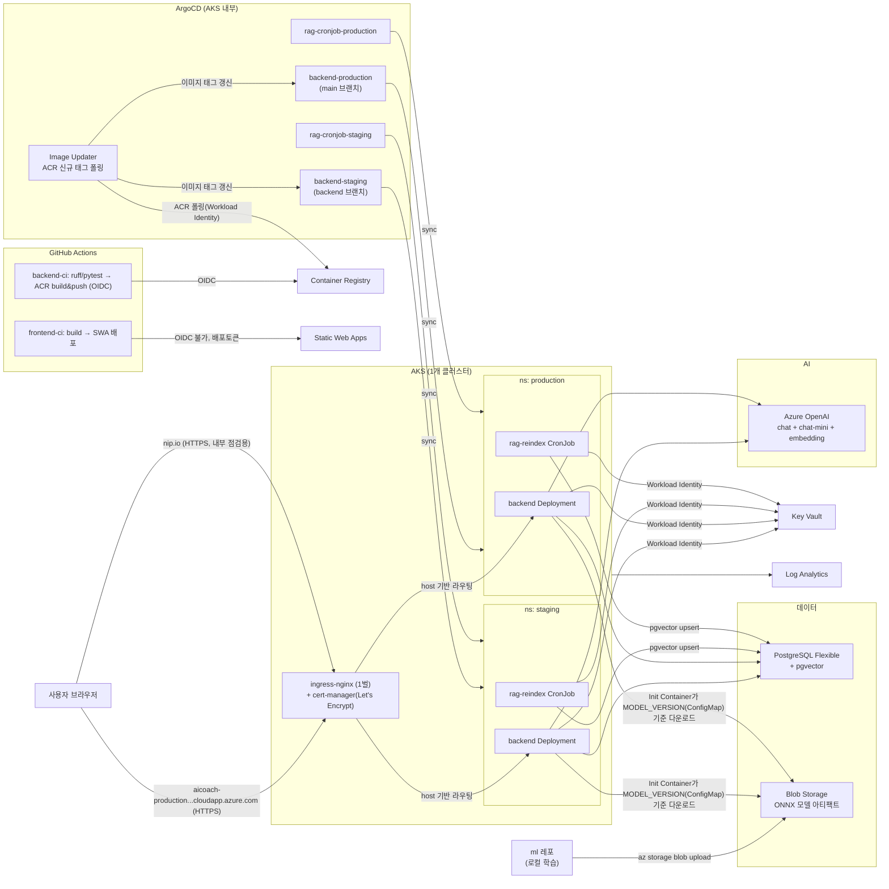

# 인프라 (Azure, AKS 기반)

백엔드는 AKS(Kubernetes)에 ArgoCD(GitOps)로 배포하고, 프론트엔드는 Static Web Apps에 정적 호스팅한다.
IaC는 Bicep, 시크릿은 Key Vault + AKS Workload Identity(OIDC)로 코드/매니페스트에 값이 노출되지 않게 한다.
**AKS는 1개 클러스터**이고 그 안에서 `staging`/`production` 네임스페이스로 환경을 나눈다(예산 제약상 클러스터 2개는 안 씀).

이 프로젝트 전체를 관통하는 원칙: **정적 자격증명 대신 AAD/Managed Identity**. kubectl 접근(Azure AD RBAC),
백엔드→OpenAI/KeyVault/Postgres(Workload Identity), ArgoCD Image Updater→ACR(전용 Workload Identity),
kubelet→ACR(kubelet identity)까지 전부 이 원칙으로 통일했고, Azure OpenAI는 API 키 자체를 비활성화
(`disableLocalAuth: true`)했다. 예외는 Postgres admin 계정(비밀번호 병행 — 사람이 쓰는 초기 설정용)과
`infra/.env`뿐, 둘 다 git 밖으로 분리돼 있다.

## 리소스 구성

| 리소스 | 역할 |
|---|---|
| **AKS** | backend Deployment + rag-reindex CronJob 런타임. **System/User 노드풀 분리**(`system`: `Standard_B2s` 고정 1대 + `CriticalAddonsOnly` taint로 kube-system 전용, `user`: `Standard_D2s_v5` 오토스케일 1~6로 앱 워크로드 전용) + Workload Identity(OIDC) + Container Insights. `staging`/`production` 네임스페이스로 환경 분리. **kubectl 접근은 Azure AD RBAC**(`clusterAdminPrincipalIds`로 admin 등록, 로컬 계정 비활성화는 안 함 — 구독 Owner/Contributor 비상 접근 유지) |
| **Container Registry** | 백엔드 이미지(backend Deployment와 rag-reindex CronJob이 같은 이미지 공유). kubelet identity에 AcrPull, ArgoCD Image Updater는 전용 Workload Identity로 AcrPull(정적 토큰 없음) |
| **Key Vault** | 시크릿 저장(Azure OpenAI 키, DB 연결정보 등). RBAC 인증, 앱은 Workload Identity로 직접 조회 |
| **PostgreSQL Flexible Server** | 세션/판정/트레이스 + pgvector(RAG). `azure.extensions=VECTOR` 활성화. MVP는 public+방화벽(VNet 미사용). AAD 인증을 비밀번호 인증과 병행(backend Managed Identity가 AAD 관리자로 등록) |
| **Blob Storage** | ml 레포가 학습한 ONNX 모델 아티팩트. `models/<version>/model.onnx` 경로 규칙, backend workload identity에 Blob 읽기 권한만 부여 |
| **Azure OpenAI** | `chat`(gpt-5.4) + `chat-mini`(gpt-5.4-mini, coach/safety/planner) + `embedding`(text-embedding-3-small, retriever/rag 인덱싱) 배포 분리. **API 키 완전 비활성화**(`disableLocalAuth: true`) — backend Managed Identity에 "Cognitive Services OpenAI User" RBAC만 부여 |
| **Static Web Apps** | 프론트엔드 정적 호스팅 (Free) |
| **Log Analytics + App Insights** | AKS Container Insights + 앱 관측성 |

## 배포 단위 (4개 ArgoCD Application)

| Application | 브랜치 | 네임스페이스 | K8s 리소스 |
|---|---|---|---|
| `backend-staging` | `backend` | `staging` | Deployment(상시 서빙) |
| `backend-production` | `main` | `production` | Deployment(상시 서빙) |
| `rag-cronjob-staging` | `backend` | `staging` | CronJob(주기적 재인덱싱, 매일 03:00) |
| `rag-cronjob-production` | `main` | `production` | CronJob |

backend와 rag는 **같은 브랜치(backend/main), 같은 Docker 이미지**를 쓰지만(코드가 `backend/rag/`에 같이 있음, pgvector라 DB 커넥션도 공유)
배포 단위(ArgoCD Application)만 나눠서, RAG 재인덱싱을 상시 서빙 Deployment 재시작 없이 독립적으로 sync/pause할 수 있게 했다.

## ML 모델 버전 관리 (ml 레포 multi-source + Reloader, 2026-08-13 개편)

1. ml 레포가 로컬 학습 → `az storage blob upload`로 `models/<version>/model.onnx` 업로드
2. ml 레포 자신의 `k8s/model-version/configmap-model-version.yaml`(`MODEL_VERSION`)을 그 버전으로 **바로 커밋**
   (이 레포에 PR 필요 없음 — ml팀 소유 레포라 리뷰 없이 자기 파이프라인이 바로 반영)
3. `infra/k8s/apps/{backend,rag-cronjob}-*.yaml`의 ArgoCD Application이 **multi-source**로 이 레포(overlay)와
   ml 레포(`k8s/model-version/`)를 같은 네임스페이스에 같이 배포 — ArgoCD가 ml 레포 변경을 감지해서 ConfigMap을 갱신
4. **Reloader**(`infra/ansible/playbooks/bootstrap-cluster.yml`가 설치)가 그 ConfigMap 변경을 감지해서 backend
   Deployment를 자동 롤링 재시작(`reloader.stakater.com/auto` 어노테이션 기준) — 수동 `kubectl rollout restart` 불필요.
   rag-cronjob은 매일 03:00 새 Pod로 뜨므로 별도 트리거 없이 자연히 최신 값을 읽음
5. Deployment의 **Init Container**(`fetch-model`)가 `MODEL_VERSION`에 해당하는 blob을 내려받아 emptyDir(`model-cache`)에 저장 → 메인 컨테이너(`backend/app/inference/`)가 그걸 로드
6. 즉 모델 자체는 git에 안 올라가고, **버전 태그만 GitOps로 관리**되되 그 git이 이 레포가 아니라 ml 레포임

이전엔 `infra/k8s/base/{backend,rag-cronjob}/configmap-model-version.yaml`을 이 레포에 PR하는 방식이었는데,
ml팀 입장에서 매번 이 레포에 PR 올려야 하는 게 번거롭고 수동 재시작도 귀찮다는 피드백으로 위 방식으로 변경함.

## ArgoCD (GitOps)

`infra/k8s/argocd/`(설치) + `infra/k8s/apps/`(app-of-apps, 이 4개 Application 정의) + `infra/k8s/root-app.yaml`
(app-of-apps 루트 — `infra/k8s/apps/`를 관리) 구조. root-app을 apps/ 폴더 밖에 두는 이유: root-app이 자기 자신이
관리하는 폴더 안에 있으면 ArgoCD가 자기 자신을 대상으로 sync/prune하게 돼서(자기참조), `prune: true`인 상태에서
누군가 폴더 구조를 바꾸면 root-app이 스스로를 지워버릴 수 있음(2026-08-13, 리뷰 중 발견해서 분리).
기존 홈랩 프로젝트(`k3s-repo`)의 app-of-apps 패턴을 재사용하되, 시크릿 백엔드만 SealedSecrets → Key Vault CSI+Workload Identity로 교체했다.
프론트는 ArgoCD 범위 밖(SWA로 별도 배포).

**Image Updater**가 ACR 신규 태그를 폴링해 `backend-staging`/`backend-production` Application의 이미지를
자동 갱신한다(git write-back 아니라 Application 파라미터 override). ACR 인증은 전용 Workload Identity
(`imageUpdaterIdentity`, backend Identity와 분리) — static docker-registry secret 없음. 상세는
[k8s/argocd/README.md](k8s/argocd/README.md) 참고.

## 배포 순서

1. `az group create` (수동, Bicep은 리소스그룹 스코프)
2. `az bicep build --file infra/bicep/main.bicep` — 로컬 검증
3. `az deployment group what-if ...` — 드라이런
4. `az deployment group create ...` — 실배포 (또는 `infra-deploy.yml` workflow_dispatch)
5. ArgoCD 설치 (`infra/k8s/argocd/README.md` 참고) → `kubectl apply -f infra/k8s/root-app.yaml`
6. Bicep 출력값(`backendIdentityClientId`, `keyVaultUri`, `storageAccountName` 등)으로 `infra/k8s/base/**/*.yaml`의 `<PLACEHOLDER>` 값 채워서 재커밋

## 알려진 트레이드오프 (시간/예산 제약)

- **AKS 클러스터 1개 공유**: staging/production을 네임스페이스로만 분리 — 클러스터 격리 수준의 안전성은 아님(노드/네트워크는 공유).
- **VNet 미사용**: Postgres/AKS 모두 퍼블릭 액세스 + 방화벽 허용목록. 시간 여유 시 Private Endpoint로 전환 권장.
- **Ingress: NGINX 1벌로 확정** (`infra/k8s/ingress-nginx/README.md`). HAProxy도 로컬 사용 경험이 있어 후보였지만 생태계가 더 큰 NGINX로 결정 — 성능 이슈 생기면 HAProxy로 교체 후보. Azure 별도 유료 리소스 아님(AGIC였다면 Application Gateway가 필요했을 것). **도메인**: 실도메인 구매 대신 Azure LoadBalancer 자동생성 DNS 라벨(무료) — production은 `aicoach-production.koreacentral.cloudapp.azure.com`, staging은 같은 컨트롤러의 같은 공인 IP를 `nip.io`로 재사용(브라우저가 staging 백엔드를 직접 호출하는 경로가 없어서 별도 컨트롤러/도메인 불필요). **TLS**: cert-manager + Let's Encrypt 자동 발급(`infra/k8s/cert-manager/README.md`). production 호스트는 확정 완료, staging 호스트는 ingress-nginx 설치 후 실제 IP가 나와야 알 수 있어 `<STAGING_NIP_IO_HOST_TBD>` 자리표시자로 남아있음.
- **Init Container 인증 플래그 미검증**: `az login --identity`가 AKS Workload Identity federation과 실제로 맞물리는지 실배포 시 확인 필요.
- **Static Web Apps 배포는 OIDC 미지원**: `AZURE_STATIC_WEB_APPS_API_TOKEN`을 GitHub Secrets에 등록 필요(SWA 리소스 생성 후 `az staticwebapp secrets list`로 확인).

## 필요한 GitHub 설정

| 이름 | 종류 | 값 |
|---|---|---|
| `AZURE_CLIENT_ID` / `AZURE_TENANT_ID` / `AZURE_SUBSCRIPTION_ID` | Secret | OIDC 페더레이션용 (장기 키 없음) |
| `AZURE_STATIC_WEB_APPS_API_TOKEN` | Secret | SWA 배포 토큰 (OIDC 미지원) |
| `VITE_API_BASE` | Secret | 프론트 빌드 시 주입할 백엔드 API 주소 — `https://aicoach-production.koreacentral.cloudapp.azure.com`(cert-manager 인증서 발급 확인 후 등록) |
| `AZURE_RG` / `ACR_NAME` / `ACR_LOGIN_SERVER` / `AKS_NAME` | **Variable**(Settings → Actions → Variables) | 비밀 아님, 리소스 이름일 뿐 — Secrets에 넣지 않음 |
