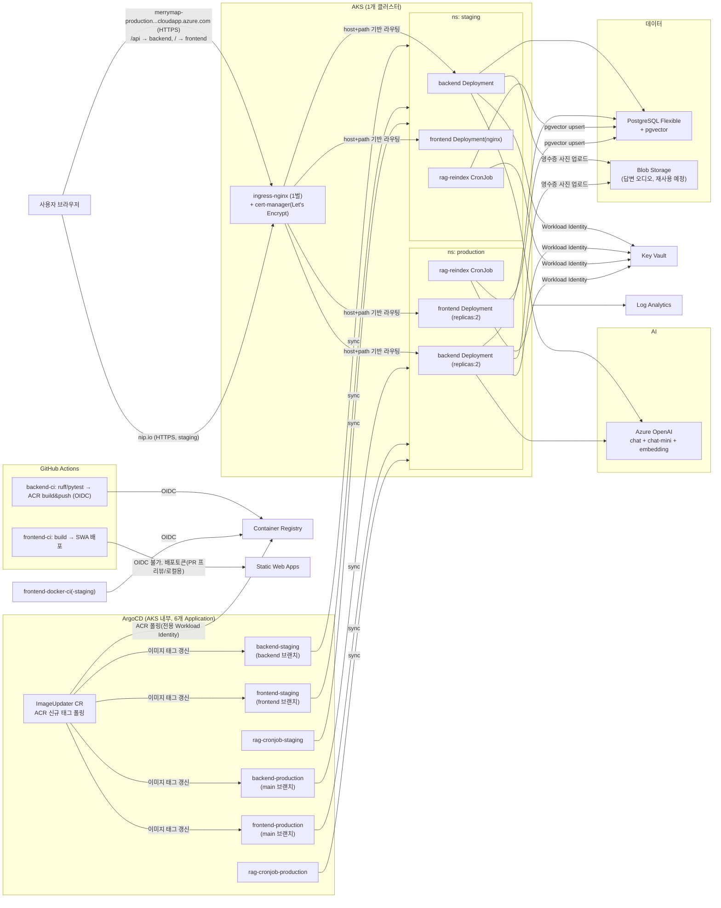

# 인프라 (Azure, AKS 기반)

백엔드와 프론트엔드 모두 AKS(Kubernetes)에 ArgoCD(GitOps)로 배포한다(2026-08-26부터 — 그 전엔
프론트가 Static Web Apps 단독이었다. SWA는 폐기가 아니라 PR 프리뷰/로컬 크로스오리진 검증용으로
병행 운영 중). 백엔드 `/api`, 프론트엔드 `/`가 같은 AKS Ingress 호스트 아래 same-origin으로
서빙된다 — Safari(ITP)/Brave(Shields)의 서드파티 쿠키 차단으로 로그인이 안 되던 문제를 근본적으로
없앤 조치다.
IaC는 Bicep, 시크릿은 Key Vault + AKS Workload Identity(OIDC)로 코드/매니페스트에 값이 노출되지 않게 한다.
**AKS는 1개 클러스터**이고 그 안에서 `staging`/`production` 네임스페이스로 환경을 나눈다(예산 제약상 클러스터 2개는 안 씀).

이 프로젝트 전체를 관통하는 원칙: **정적 자격증명 대신 AAD/Managed Identity**. kubectl 접근(Azure AD RBAC),
백엔드→OpenAI/KeyVault/Postgres(Workload Identity), ArgoCD Image Updater→ACR(전용 Workload Identity),
kubelet→ACR(kubelet identity)까지 전부 이 원칙으로 통일했고, Azure OpenAI는 API 키 자체를 비활성화
(`disableLocalAuth: true`)했다. 예외는 Postgres admin 계정(비밀번호 병행 — 사람이 쓰는 초기 설정용)과
`infra/.env`뿐, 둘 다 git 밖으로 분리돼 있다.



## 리소스 구성

| 리소스 | 역할 |
|---|---|
| **AKS** | backend/frontend Deployment + rag-reindex CronJob 런타임. **System/User 노드풀 분리**(`system`: `Standard_B2s` 고정 1대 + `CriticalAddonsOnly` taint로 kube-system 전용, `user`: `Standard_D2s_v5` 오토스케일 1~6로 앱 워크로드 전용) + Workload Identity(OIDC) + Container Insights. `staging`/`production` 네임스페이스로 환경 분리. 세 워크로드 모두 `resources.requests/limits` 지정(backend 100m/200Mi~500m/400Mi, frontend nginx 20m/32Mi~100m/64Mi, rag-index 100m/256Mi~500m/512Mi — 실측 `kubectl top pod` 기반), `backend-production`/`frontend-production`은 `replicas: 2`(staging은 데모 규모라 의도적으로 1개 유지). **kubectl 접근은 Azure AD RBAC**(`clusterAdminPrincipalIds`로 admin 등록, 로컬 계정 비활성화는 안 함 — 구독 Owner/Contributor 비상 접근 유지) |
| **Container Registry** | backend·frontend·rag-reindex 이미지(backend Deployment와 rag-reindex CronJob은 같은 이미지 공유, frontend는 별도 이미지 — `VITE_API_BASE`가 빌드 타임에 baked-in이라 staging/production 태그가 분리됨). kubelet identity에 AcrPull, ArgoCD Image Updater는 전용 Workload Identity로 AcrPull(정적 토큰 없음). 주간 purge task가 backend/frontend 저장소 모두 대상 |
| **Key Vault** | 시크릿 저장(Azure OpenAI 키, DB 연결정보, 소셜 로그인/Langfuse/Blob endpoint 등). RBAC 인증, 앱은 Workload Identity로 직접 조회. 외부 SaaS 시크릿(사람이 발급받는 값)도 Bicep이 `Microsoft.KeyVault/vaults/secrets`로 직접 작성하는 게 이 프로젝트의 표준 패턴 |
| **PostgreSQL Flexible Server** | 세션/판정/트레이스 + pgvector(RAG, **HNSW 인덱스** — 2026-08-26 ivfflat에서 전환). `azure.extensions=VECTOR` 활성화. MVP는 public+방화벽(VNet 미사용). AAD 인증을 비밀번호 인증과 병행(backend Managed Identity가 AAD 관리자로 등록). 실제 DB 이름은 `team4db-wd`(`postgresDatabaseName` 파라미터 기본값 — 한때 `postgres` 기본 DB로 잘못 연결돼 로그인 500 장애를 낸 적 있음, 아래 "알려진 트레이드오프" 참고) |
| **Blob Storage** | `receipts` 컨테이너 — 결제 영수증 사진 업로드(OCR 자동입력 기능, `backend/app/core/storage.py`가 httpx로 Blob REST API 직접 호출, `azure-storage-blob`/`aiohttp` 미사용). Managed Identity로 인증(`AZURE_STORAGE_BLOB_ENDPOINT` 시크릿) |
| **Azure OpenAI** | `chat`(gpt-5.4) + `chat-mini`(gpt-5.4-mini, 영수증 OCR vision 포함) + `embedding`(text-embedding-3-small, RAG 인덱싱/검색) 배포 분리. **API 키 완전 비활성화**(`disableLocalAuth: true`) — backend Managed Identity에 "Cognitive Services OpenAI User" RBAC만 부여. 타임아웃은 `Settings.azure_openai_timeout_seconds`(기본 45초)로 명시 지정 |
| **Static Web Apps** | 프론트엔드 PR 프리뷰 + 로컬 크로스오리진 개발/테스트용 정적 호스팅(Free) — production 트래픽은 AKS가 서빙 |
| **Log Analytics + App Insights** | AKS Container Insights. 앱 관측성은 App Insights가 아니라 Langfuse(아래 참고) + 표준 stdout 로깅(`logging.basicConfig` + 전역 예외 핸들러) — 이 프로젝트 YAGNI 목록상 App Insights는 배제 |

## 배포 단위 (6개 ArgoCD Application)

| Application | 브랜치 | 네임스페이스 | K8s 리소스 |
|---|---|---|---|
| `backend-staging` | `backend` | `staging` | Deployment(상시 서빙) |
| `backend-production` | `main` | `production` | Deployment(상시 서빙, replicas:2) |
| `frontend-staging` | `frontend` | `staging` | Deployment(nginx, 상시 서빙) |
| `frontend-production` | `main` | `production` | Deployment(nginx, 상시 서빙, replicas:2) |
| `rag-cronjob-staging` | `backend` | `staging` | CronJob(주기적 재인덱싱, 매일 03:00) |
| `rag-cronjob-production` | `main` | `production` | CronJob |

backend와 rag는 **같은 브랜치(backend/main), 같은 Docker 이미지**를 쓰지만(코드가 `backend/app/rag/`에 같이 있음, pgvector라 DB 커넥션도 공유)
배포 단위(ArgoCD Application)만 나눠서, RAG 재인덱싱을 상시 서빙 Deployment 재시작 없이 독립적으로 sync/pause할 수 있게 했다.
frontend는 별도 브랜치·별도 이미지(2026-08-26부터 ArgoCD 범위)로, backend와 같은 Ingress 호스트 아래
same-origin(`/`)으로 서빙된다.

> **브리프코치 피벗(2026-08-19) 이후**: 여기 있던 "ML 모델 버전 관리" 절(ml 레포 multi-source +
> Reloader)을 제거했다 — 커스텀 모델(TCN)이 없어졌다. 전체 흐름은
> [`infra/old/모델버전-GitOps.md`](old/모델버전-GitOps.md)에 보존돼 있다.

## ArgoCD (GitOps)

`infra/k8s/argocd/`(설치) + `infra/k8s/apps/{staging,production}/`(app-of-apps, 이 6개 Application
정의) + `infra/k8s/root-app-{staging,production}.yaml`(app-of-apps 루트 2개) 구조. root-app을
apps/ 폴더 밖에 두는 이유: root-app이 자기 자신이 관리하는 폴더 안에 있으면 ArgoCD가 자기 자신을
대상으로 sync/prune하게 돼서(자기참조), `prune: true`인 상태에서 누군가 폴더 구조를 바꾸면
root-app이 스스로를 지워버릴 수 있음(2026-08-13, 리뷰 중 발견해서 분리). **2026-08-26 root-app
분리**: 원래는 root-app 하나가 `main` 기준으로 `infra/k8s/apps/` 전체를 읽어서, staging용
Application을 추가해도 main 승격 전까지는 못 봤다 — root-app을 staging(`backend` 브랜치 추적)/
production(`main` 브랜치 추적)으로 나눠 staging Application 추가/변경이 main 승격 없이 즉시
반영되게 했다. 기존 홈랩 프로젝트(`k3s-repo`)의 app-of-apps 패턴을 재사용하되, 시크릿 백엔드만
SealedSecrets → Key Vault CSI+Workload Identity로 교체했다.
프론트는 **2026-08-26부터 ArgoCD 범위 안**(`frontend-{staging,production}` Application,
같은 AKS Ingress 호스트에 nginx 컨테이너로 same-origin 배포) — SWA는 폐기 아니고 PR
프리뷰/로컬용으로 병행.

**Image Updater**가 ACR 신규 태그를 폴링해 `backend-{staging,production}`/`frontend-{staging,production}`
Application의 이미지를 자동 갱신한다(git write-back 아니라 Application 파라미터 override). ACR 인증은
전용 Workload Identity(`imageUpdaterIdentity`, backend Identity와 분리) — static docker-registry
secret 없음. 상세는 [k8s/argocd/README.md](k8s/argocd/README.md) 참고.

> **⚠️ 설치 후 한동안 완전히 작동하지 않았다 (2026-08-26 발견·수정)**
>
> 설치된 `argocd-image-updater:v1.3.0`은 CRD 기반 재설계 버전이라, Application의
> `argocd-image-updater.argoproj.io/*` 어노테이션만으로는 아무것도 안 하고 **`ImageUpdater` 커스텀
> 리소스가 별도로 있어야** 그 어노테이션을 실제로 읽는다 — `ImageUpdater` CR이 하나도 없었으므로
> "CI가 이미지 push → Image Updater가 감지 → 자동 배포" 파이프라인 전체가 설치 이후 한 번도 작동한 적
> 없었다. `infra/k8s/argocd/argocd-image-updater-crs.yaml`(`namePattern: "*"` + `useAnnotations: true`)을
> 추가해 해결. 이 CR을 적용하자 바로 두 번째 독립된 버그가 드러났다: ACR 인증이 `401
> Unauthorized`로 실패 — `aks.bicep`의 `imageUpdaterFederatedCredential`이 참조하는
> `imageUpdaterServiceAccountName` 기본값이 업스트림의 2026-08-14 컨트롤러 이름 변경
> (`argocd-image-updater` → `argocd-image-updater-controller`) 이후 갱신되지 않아 federated
> credential의 subject가 존재하지 않는 서비스어카운트를 가리키고 있었다. Bicep 기본값과 라이브
> federated credential 둘 다 수정 완료.

## 배포 순서

1. `az group create` (수동, Bicep은 리소스그룹 스코프)
2. `az bicep build --file infra/bicep/main.bicep` — 로컬 검증
3. `az deployment group what-if ...` — 드라이런
4. `az deployment group create ...` — 실배포 (또는 `infra-deploy.yml` workflow_dispatch)
5. ArgoCD 설치 (`infra/k8s/argocd/README.md` 참고) → `kubectl apply -f infra/k8s/root-app-staging.yaml`
   → `kubectl apply -f infra/k8s/root-app-production.yaml`
6. Bicep 출력값(`backendIdentityClientId`, `keyVaultUri`, `storageAccountName` 등)으로 `infra/k8s/base/**/*.yaml`의 `<PLACEHOLDER>` 값 채워서 재커밋

## 알려진 트레이드오프 (시간/예산 제약)

- **AKS 클러스터 1개 공유**: staging/production을 네임스페이스로만 분리 — 클러스터 격리 수준의 안전성은 아님(노드/네트워크는 공유).
- **VNet 미사용**: Postgres/AKS 모두 퍼블릭 액세스 + 방화벽 허용목록. 시간 여유 시 Private Endpoint로 전환 권장.
- **Ingress: NGINX 1벌로 확정** (`infra/k8s/ingress-nginx/README.md`). HAProxy도 로컬 사용 경험이 있어 후보였지만 생태계가 더 큰 NGINX로 결정 — 성능 이슈 생기면 HAProxy로 교체 후보. Azure 별도 유료 리소스 아님(AGIC였다면 Application Gateway가 필요했을 것). **도메인**: 실도메인 구매 대신 Azure LoadBalancer 자동생성 DNS 라벨(무료) — production은 `merrymap-production.koreacentral.cloudapp.azure.com`, staging은 같은 컨트롤러의 같은 공인 IP를 `nip.io`로 재사용(브라우저가 staging 백엔드를 직접 호출하는 경로가 없어서 별도 컨트롤러/도메인 불필요). **TLS**: cert-manager + Let's Encrypt 자동 발급(`infra/k8s/cert-manager/README.md`). production 호스트는 확정 완료. staging 호스트도 이제 확정 완료(2026-08-24 ingress-nginx 설치 후 실제 IP `20.249.52.148` 확인, `k8s/overlays/backend-staging/ingress.yaml`에 `20-249-52-148.nip.io`로 반영, staging 라이브 배포로 실측 검증됨) — 이 문단이 한동안 `<STAGING_NIP_IO_HOST_TBD>` 자리표시자로 남아있었는데 실제로는 이미 채워져 있었던 문서 드리프트였다(2026-08-25 확인 및 정정).
  - **staging/production URL·CORS·OAuth redirect 설정은 이미 양쪽 다 완전히 배선되어 있다** — `k8s/overlays/backend-{staging,production}/kustomization.yaml`이 각각 `OAUTH_BACKEND_BASE_URL`/`FRONTEND_BASE_URL`을 실제 값으로 패치하고 있다(플레이스홀더 아님). 이 프로젝트의 "프로모션"은 설정을 주석 해제/교체하는 별도 단계가 아니라 **`backend`/`frontend` → `main` PR 머지 그 자체**다(`backend-production`/`frontend-production` ArgoCD Application이 `targetRevision: main`을 `automated{prune:true, selfHeal:true}`로 추적하므로 머지 즉시 배포됨). **(2026-08-28 갱신)** 한때 `main`이 `backend`보다 83커밋 뒤처져 있던 시기가 있었으나, 이후 반복적으로 `backend`→`main`/`frontend`→`main` 프로모션 PR이 올라가며 지금은 정기적으로 동기화되고 있다 — 다만 프로모션은 여전히 자동이 아니라 PR 머지가 트리거이므로, 두 브랜치 사이 격차가 다시 벌어질 수 있다는 점 자체는 구조적으로 남아있다.
  - **Postgres DB 이름 기본값 실수가 실제 로그인 장애로 이어진 적 있다 (2026-08-26)**: `postgresDatabaseName` 파라미터가 세 곳(main.bicep/postgres.bicep 기본값 + `infra-deploy.yml`)에서 서버 기본 DB인 `postgres`로 폴백하도록 돼 있어, 실배포마다 `pg-connstr` Key Vault 시크릿이 마이그레이션 안 된 `postgres` DB를 가리키도록 조용히 되돌려졌다 — `POST /auth/login`이 `relation "users" does not exist` 500을 냈다. 세 곳 기본값을 실제 DB 이름(`team4db-wd`)으로 고정해서 해결. **환경변수 배선 없이 기본값만 바꾸는 방식은 다음 배포에서 같은 문제를 반복할 수 있으니, 인프라 배포 전엔 `DATABASE_NAME`이 실제로 넘어가는지 확인할 것.**
  - **chat SSE가 60초 프록시 타임아웃에 종종 끊겼다 (2026-08-26)**: ingress-nginx의 기본 `proxy-read/send-timeout`(60초)과 Azure OpenAI 클라이언트의 기본 타임아웃(SDK 기본 600초)이 어긋나 있어, `verify_answer`/`reformulate_query`처럼 스트리밍하지 않는 호출이 느려지면 SSE 바이트가 하나도 안 나가는 채로 프록시가 먼저 연결을 끊었다. `backend-{staging,production}/ingress.yaml`의 타임아웃을 120초로 올리고, `Settings.azure_openai_timeout_seconds`(45초)를 명시 지정하고, 15초마다 SSE 하트비트 주석(`: heartbeat\n\n`)을 내보내는 3중 조치로 해결.
  - **영수증 업로드가 413으로 막힌 적 있다**: ingress-nginx 기본 `proxy-body-size`가 사진 업로드 크기보다 작아서 발생 — annotation 추가로 해결.
- **Init Container 인증 플래그 미검증**: `az login --identity`가 AKS Workload Identity federation과 실제로 맞물리는지 실배포 시 확인 필요.
- **Static Web Apps 배포는 OIDC 미지원**: `AZURE_STATIC_WEB_APPS_API_TOKEN`을 GitHub Secrets에 등록 필요(SWA 리소스 생성 후 `az staticwebapp secrets list`로 확인).

## 필요한 GitHub 설정

### GitHub Secrets (Settings → Secrets and variables → Actions → Secrets)

| 이름 | 값 | 비고 |
|---|---|---|
| `AZURE_CLIENT_ID` | Azure AD App Registration의 `appId` | 아래 "Azure AD OIDC 설정" 참고 |
| `AZURE_TENANT_ID` | `az account show --query tenantId -o tsv` | |
| `AZURE_SUBSCRIPTION_ID` | `az account show --query id -o tsv` | |
| `AZURE_STATIC_WEB_APPS_API_TOKEN` | `az staticwebapp secrets list --name <prefix>-swa --resource-group <RG> --query properties.apiKey -o tsv` | SWA는 OIDC 미지원이라 이것만 예외적으로 장기 토큰 사용 |
| `VITE_API_BASE` | 프론트 빌드 시 주입할 백엔드 API 주소(P3에서 확정한 production 호스트) | cert-manager 인증서 발급 확인 후 등록 |
| `POSTGRES_ADMIN_PASSWORD` | `infra/.env`의 값 그대로 | **여기 README/문서에 실제 값 절대 적지 말 것** — 평문 커밋된 적 있음(2026-08-13). ⚠️ 아래 "히스토리 잔존" 참고 |
| `GOOGLE_CLIENT_ID` / `GOOGLE_CLIENT_SECRET` | Google Cloud Console에서 발급 | 소셜 로그인(`00_BASELINE.md` §0-2 Should). 2026-08-24 IaC화(`infra/docs/iac.md` §Key Vault 시크릿 자동화 참고) — 등록 안 하면 `dev.bicepparam`이 `CHANGE_ME_LOCAL_ONLY`로 폴백(파드는 뜨지만 로그인은 안 됨) |
| `NAVER_CLIENT_ID` / `NAVER_CLIENT_SECRET` | 네이버 개발자센터에서 발급 | 위와 동일 |
| `LANGFUSE_PUBLIC_KEY` / `LANGFUSE_SECRET_KEY` | Langfuse Cloud 프로젝트 설정에서 발급 | `14_langfuse_tracing_design.md`. **⚠️ 이미 라이브로 쓰이는 값** — GitHub Secrets 미등록 상태로 `infra-deploy.yml`을 `workflow_dispatch`(whatIf:false)로 실배포하면 `CHANGE_ME_LOCAL_ONLY`로 덮어써서 기존 정상 동작하던 트레이싱이 깨진다. **실배포 전 반드시 먼저 등록할 것** |
| `AZURE_STORAGE_BLOB_ENDPOINT` | `az storage account show -n <이름> --query primaryEndpoints.blob -o tsv` | 영수증 OCR 업로드(`receipts` 컨테이너)용. Bicep IaC는 코드상 존재하지만 실배포가 누락돼 신규 backend 파드가 `ContainerCreating`에서 멈춘 적 있음 — 인프라 변경 후엔 반드시 실제 `workflow_dispatch`(whatIf:false)로 배포까지 확인할 것 |
| (카카오/애플 OAuth 4종) | — | PR #48(backend)/#49(infra Key Vault IaC)에 코드는 준비돼 있으나 **의도적으로 머지 보류 중** — 머지 전까지는 등록 불필요, 머지 시 #49(Key Vault)가 #48(backend)보다 먼저 배포돼야 함(순서 어기면 필수 `Settings` 필드 누락으로 파드가 부팅 시 크래시) |

> **⚠️ 이 문서의 이전 기술은 사실과 달랐다 (2026-08-19 정정)**
>
> 예전에 여기 "git 히스토리까지 재작성해서 지운 전례 있음"이라고 적혀 있었다. **재작성은 없었다.**
> `595a12f`는 파일 내용에서만 지웠고, 평문 값은 지금도 **11개 커밋**에 남아 있다
> (`main`·`backend`·`feature/backend` 세 브랜치 모두의 조상 — GitHub compare API로 확인).
> 브랜치 tip은 모두 깨끗하지만, 저장소 접근 권한이 있으면 히스토리에서 복원할 수 있다.
>
> 이 문장이 제일 위험했다 — 팀이 "이미 정리됐다"고 믿게 만들어 **대응이 필요하다는 판단 자체를
> 막고 있었기 때문**이다. 경위·노출 범위와 결정(회전하지 않음, 2026-08-19) 기록은
> [시크릿-회전.md](./시크릿-회전.md) 참고.

### GitHub Variables (Settings → Secrets and variables → Actions → Variables)

| 이름 | 값 | 비고 |
|---|---|---|
| `AZURE_RG` | 리소스그룹 이름 | 비밀 아님, 리소스 이름일 뿐 |
| `ACR_NAME` | `<prefix>acr` (하이픈 제거) | `acr.bicep`의 이름 규칙과 동일 |
| `ACR_LOGIN_SERVER` | **`az acr show -n <ACR_NAME> --query loginServer -o tsv \| tr -d '\r'`** | ⚠️ 유추 금지 + `tr -d '\r'` 생략 금지 — 아래 참고 |
| `AKS_NAME` | `<prefix>-aks` | Bicep 출력값 `aksName` |

> **`ACR_LOGIN_SERVER`를 손으로 조합하면 안 되는 이유** (2026-08-19 실제 CI 실패)
>
> 이 값은 `<prefix>acr.azurecr.io`가 **아니다.** Azure는 ACR 로그인 서버에 전역 이름 충돌을
> 막기 위한 고유 접미사를 붙이므로 실제 값은 `<prefix>acr-<임의문자열>.azurecr.io` 형태다.
> 정본은 Bicep 출력 `acrLoginServer`(= `acr.properties.loginServer`, `bicep/modules/acr.bicep`)이고,
> 그걸 조회하는 가장 짧은 방법이 위 `az acr show` 명령이다.
>
> **`| tr -d '\r'`를 빼면 안 된다** (2026-08-19 실제로 두 번째 CI 실패를 냈다).
> WSL에서 `az`를 부르면 `appendWindowsPath=true` 때문에 Windows용 Azure CLI
> (`/mnt/c/Program Files/Microsoft SDKs/Azure/CLI2/wbin/az`)가 잡히고, 그 출력은 CRLF다.
> `$(...)`는 끝의 `\n`만 떼므로 `\r`가 값에 남아 GitHub Variable에 그대로 저장된다.
> 눈으로는 안 보이지만 빌드는 이렇게 죽는다:
> `invalid tag "team4hcacr-....azurecr.io\r/backend:<sha>": invalid reference format`
>
> 실제로 이 문서가 `<prefix>acr.azurecr.io`로 안내한 탓에 Variables에 접미사 없는 값이 등록됐고,
> `backend-ci`의 이미지 push가 `dial tcp: lookup team4hcacr.azurecr.io: no such host`로 실패해
> **ArgoCD Image Updater가 감지할 새 태그가 없어 배포가 멈춰 있었다.**
> 커밋 `053b18d`이 같은 문제를 K8s 매니페스트 4개에서 고쳤지만 이 변수와 문서는 남아 있었다
> (같은 뿌리의 이름 충돌 이슈는 `트러블슈팅.md` #1의 `aicoachacr` 폐기 건).

### Azure AD OIDC 설정 (GitHub Actions가 장기 키 없이 Azure에 로그인하는 절차)

**개념**: 4단계가 순서대로 이어져야 `azure/login@v2`가 동작한다.

| 단계 | 명령 | 하는 일 |
|---|---|---|
| 1. App Registration | `az ad app create --display-name "<repo>-github-oidc"` | 앱 정의를 테넌트에 등록, `appId` 발급 |
| 2. Service Principal | `az ad sp create --id <appId>` | 그 앱의 실제 인스턴스 생성 — **role assignment는 SP한테 하는 것**이라 이게 있어야 권한을 줄 수 있음 |
| 3. Federated Credential | `az ad app federated-credential create --id <appId> --parameters '{...}'` | "GitHub Actions의 어떤 토큰(레포+브랜치/PR 조건)을 이 앱인 척 신뢰할지" 등록. `subject`의 `<org>/<repo>`는 **반드시 실제 값으로 치환** — 리터럴로 두면 등록은 되지만 어떤 토큰과도 안 맞는 죽은 credential이 됨 |
| 4. Role Assignment | `az role assignment create --assignee <appId> --role Contributor --scope <RG scope>` **+** `--role "User Access Administrator"`(같은 스코프, 별도 명령으로 한 번 더) | SP한테 실제 권한 부여 — 로그인 성공 후 실제로 리소스를 만들 수 있게 함. **`User Access Administrator`도 반드시 같이 줄 것** — 이 Bicep이 ACR AcrPull 같은 role assignment를 직접 만드는데, `Contributor`만으로는 `Microsoft.Authorization/roleAssignments/write`가 막혀있어서(Azure가 의도적으로 분리— 권한 상승 방지) `Authorization failed ... roleAssignments/write` 에러가 난다 |

트리거 종류만큼 federated credential이 필요하다 — 이 프로젝트는 `push: branches:[backend]`(Docker push)와
`pull_request:`(infra-deploy.yml what-if) 2가지라 2개 등록했다:

```bash
az ad app create --display-name "<repo>-github-oidc"
az ad sp create --id <appId>

az ad app federated-credential create --id <appId> --parameters '{
  "name": "github-backend-branch",
  "issuer": "https://token.actions.githubusercontent.com",
  "subject": "repo:<org>/<repo>:ref:refs/heads/backend",
  "audiences": ["api://AzureADTokenExchange"]
}'
az ad app federated-credential create --id <appId> --parameters '{
  "name": "github-pull-request",
  "issuer": "https://token.actions.githubusercontent.com",
  "subject": "repo:<org>/<repo>:pull_request",
  "audiences": ["api://AzureADTokenExchange"]
}'

az role assignment create --assignee <appId> --role Contributor \
  --scope /subscriptions/<subId>/resourceGroups/<RG>
```

**⚠️ GitHub OIDC subject에 조직/레포 불변 ID가 붙는 경우**: 위처럼 등록했는데도
`AADSTS700213: No matching federated identity record found ... subject 'repo:<org>@<orgId>/<repo>@<repoId>:pull_request'`
가 나면, GitHub이 `repo:<org>/<repo>:...` 대신 `repo:<org>@<orgId>/<repo>@<repoId>:...` 형식으로 토큰을
발급하는 것이다. 에러 메시지에 실제로 찍힌 subject 문자열을 그대로 복사해서 credential을 재등록하면 된다:
```bash
az ad app federated-credential delete --id <appId> --federated-credential-id github-pull-request
az ad app federated-credential create --id <appId> --parameters '{
  "name": "github-pull-request",
  "issuer": "https://token.actions.githubusercontent.com",
  "subject": "repo:<org>@<orgId>/<repo>@<repoId>:pull_request",
  "audiences": ["api://AzureADTokenExchange"]
}'
```
(`ref:refs/heads/<branch>` 트리거용 credential도 같은 레포라면 동일하게 ID가 붙으니 같이 갱신할 것.)

**⚠️ Windows Git Bash(MINGW64) 함정**: `--scope`/`--query` 등 `/`로 시작하는 인자가 있는 `az` 명령을
Git Bash에서 실행하면 MSYS의 POSIX→Windows 경로 자동변환이 그 인자를 경로로 오인해서 망가뜨린다. 구독 ID를
정확히 넣었는데도 `MissingSubscription` 에러가 나면 이게 원인이다. 명령 앞에 `MSYS_NO_PATHCONV=1`을 붙이거나
세션 시작 시 `export MSYS_NO_PATHCONV=1`로 아예 꺼두면 된다. (WSL/Linux/macOS 터미널에서는 해당 없음.)

**검증**:
```bash
MSYS_NO_PATHCONV=1 az role assignment list --scope /subscriptions/<subId>/resourceGroups/<RG> -o table
```
`--assignee <appId>`로 조회하면 방금 만든 SP라 Graph 전파 지연으로 한동안 안 나올 수 있다 — 스코프 기준
조회가 더 확실하다.
