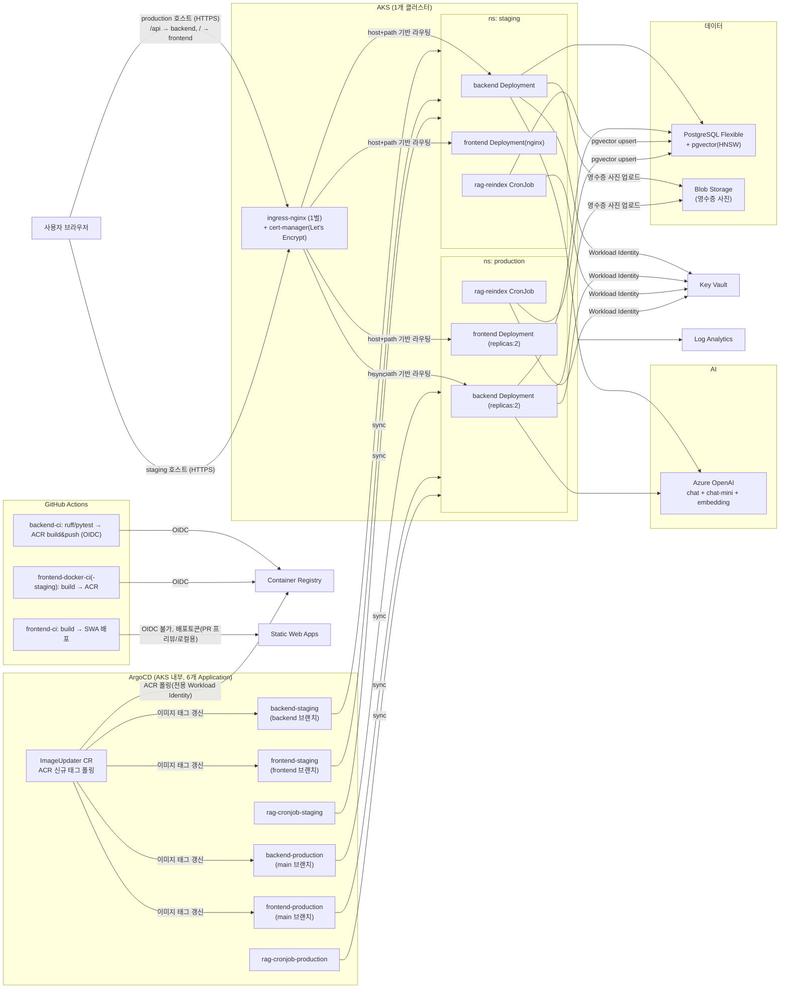

# 인프라 (Azure, AKS 기반)

백엔드와 프론트엔드 모두 AKS(Kubernetes)에 ArgoCD(GitOps)로 배포한다. 백엔드 `/api`, 프론트엔드
`/`가 같은 AKS Ingress 호스트 아래 same-origin으로 서빙된다. IaC는 Bicep, 시크릿은 Key Vault +
AKS Workload Identity(OIDC)로 코드/매니페스트에 값이 노출되지 않게 한다. **AKS는 1개 클러스터**,
그 안에서 `staging`/`production` 네임스페이스로 환경을 나눈다.

인증 원칙: 정적 자격증명 대신 **AAD/Managed Identity** — kubectl 접근(Azure AD RBAC),
백엔드→OpenAI/KeyVault/Postgres(Workload Identity), ArgoCD Image Updater→ACR(전용 Workload
Identity), kubelet→ACR(kubelet identity). Azure OpenAI는 API 키 자체를 비활성화
(`disableLocalAuth: true`). 예외는 Postgres admin 계정(비밀번호 병행)뿐이며 git 밖으로 분리돼 있다.

## 리소스 구성

| 리소스 | 역할 |
|---|---|
| **AKS** | backend/frontend Deployment + rag-reindex CronJob 런타임. System/User 노드풀 분리(`system`: 고정 1대, kube-system 전용 / `user`: 오토스케일 1~6, 앱 워크로드 전용) + Workload Identity(OIDC) + Container Insights. `staging`/`production` 네임스페이스 분리, 워크로드별 `resources.requests/limits` 지정, `*-production`은 `replicas: 2`(staging은 1). kubectl 접근은 Azure AD RBAC |
| **Container Registry** | backend·frontend·rag-reindex 이미지(backend와 rag-reindex는 이미지 공유, frontend는 `VITE_API_BASE`가 빌드타임 baked-in이라 staging/production 별도 이미지). kubelet identity에 AcrPull, Image Updater는 전용 Workload Identity로 AcrPull |
| **Key Vault** | 시크릿 저장(Azure OpenAI, DB 연결정보, 소셜 로그인, Langfuse, Blob endpoint 등). RBAC 인증, 앱은 Workload Identity로 직접 조회 |
| **PostgreSQL Flexible Server** | 세션/데이터 + pgvector(RAG, HNSW 인덱스). Public 액세스 + 방화벽 허용목록(VNet 미사용). AAD 인증을 비밀번호 인증과 병행 |
| **Blob Storage** | `receipts` 컨테이너 — 결제 영수증 사진 업로드(OCR 자동입력). Managed Identity로 인증 |
| **Azure OpenAI** | `chat` / `chat-mini`(영수증 OCR vision 포함) / `embedding` 배포 분리. API 키 비활성화(`disableLocalAuth: true`) — Managed Identity RBAC만 사용 |
| **Static Web Apps** | 프론트엔드 PR 프리뷰 + 로컬 크로스오리진 개발/테스트용 정적 호스팅 — production 트래픽은 AKS가 서빙 |
| **Log Analytics** | AKS Container Insights. 앱 관측성은 Langfuse + stdout 로깅 |

## 배포 단위 (6개 ArgoCD Application)

| Application | 브랜치 | 네임스페이스 | K8s 리소스 |
|---|---|---|---|
| `backend-staging` | `backend` | `staging` | Deployment |
| `backend-production` | `main` | `production` | Deployment(replicas:2) |
| `frontend-staging` | `frontend` | `staging` | Deployment(nginx) |
| `frontend-production` | `main` | `production` | Deployment(nginx, replicas:2) |
| `rag-cronjob-staging` | `backend` | `staging` | CronJob(매일 03:00) |
| `rag-cronjob-production` | `main` | `production` | CronJob |

backend/rag-reindex는 같은 브랜치·같은 이미지를 쓰지만 배포 단위(ArgoCD Application)만 나눠서
RAG 재인덱싱을 상시 서빙 Deployment와 독립적으로 sync/pause할 수 있게 했다.

## ArgoCD (GitOps)

`infra/k8s/argocd/`(설치) + `infra/k8s/apps/{staging,production}/`(app-of-apps, 6개 Application
정의) + `infra/k8s/root-app-{staging,production}.yaml`(app-of-apps 루트) 구조 —
staging은 `backend` 브랜치, production은 `main` 브랜치를 각각 추적한다.

**Image Updater**가 ACR 신규 태그를 폴링해 각 Application의 이미지를 자동 갱신한다(git
write-back이 아니라 Application 파라미터 override, `imageupdater.argoproj.io ImageUpdater` CR +
`useAnnotations: true`). ACR 인증은 전용 Workload Identity(`imageUpdaterIdentity`) — 상세는
[k8s/argocd/README.md](k8s/argocd/README.md) 참고.

## 배포 순서

1. `az group create` (수동, Bicep은 리소스그룹 스코프)
2. `az bicep build --file infra/bicep/main.bicep` — 로컬 검증
3. `az deployment group what-if ...` — 드라이런
4. `az deployment group create ...` — 실배포 (또는 `infra-deploy.yml` workflow_dispatch)
5. ArgoCD 설치 → `kubectl apply -f infra/k8s/root-app-staging.yaml` →
   `kubectl apply -f infra/k8s/root-app-production.yaml`
6. Bicep 출력값으로 `infra/k8s/base/**/*.yaml`의 `<PLACEHOLDER>` 값 채워서 재커밋

## 구성상 제약

- **AKS 클러스터 1개 공유** — staging/production은 네임스페이스로만 분리(노드/네트워크는 공유)
- **VNet 미사용** — Postgres/AKS 모두 퍼블릭 액세스 + 방화벽 허용목록
- **Ingress: ingress-nginx 1벌**(별도 Azure 유료 리소스 아님) + cert-manager(Let's Encrypt) 자동
  TLS 발급. 도메인은 Azure LoadBalancer 자동생성 DNS 라벨 사용(실도메인 미구매) —
  production/staging이 같은 컨트롤러의 같은 공인 IP를 서로 다른 호스트명으로 사용
- **Static Web Apps는 OIDC 미지원** — 배포 토큰을 GitHub Secrets에 장기 저장
- ingress `proxy-read/send-timeout`은 120초, `proxy-body-size`는 영수증 사진 업로드 크기를
  고려해 확장 설정

## 필요한 GitHub 설정

### GitHub Secrets (Settings → Secrets and variables → Actions → Secrets)

| 이름 | 비고 |
|---|---|
| `AZURE_CLIENT_ID` / `AZURE_TENANT_ID` / `AZURE_SUBSCRIPTION_ID` | Azure AD OIDC App Registration — 장기 키 없이 GitHub Actions가 Azure에 로그인 |
| `AZURE_STATIC_WEB_APPS_API_TOKEN` | SWA는 OIDC 미지원이라 예외적으로 장기 토큰 사용 |
| `VITE_API_BASE` | 프론트 빌드 시 주입할 백엔드 API 주소 |
| `POSTGRES_ADMIN_PASSWORD` | Postgres admin 계정 — 값은 절대 문서에 적지 않는다 |
| `GOOGLE_CLIENT_ID` / `GOOGLE_CLIENT_SECRET` | 구글 소셜 로그인 |
| `NAVER_CLIENT_ID` / `NAVER_CLIENT_SECRET` | 네이버 소셜 로그인 |
| `LANGFUSE_PUBLIC_KEY` / `LANGFUSE_SECRET_KEY` | LLM 트레이싱(Langfuse Cloud) |
| `AZURE_STORAGE_BLOB_ENDPOINT` | 영수증 OCR 업로드(`receipts` 컨테이너)용 |
| 카카오/애플 OAuth 4종 | 코드 준비 완료, 머지 보류 중 — 머지 전까지 등록 불필요 |

### GitHub Variables (Settings → Secrets and variables → Actions → Variables)

| 이름 | 비고 |
|---|---|
| `AZURE_RG` | 리소스그룹 이름 |
| `ACR_NAME` | ACR 리소스 이름 |
| `ACR_LOGIN_SERVER` | ACR 로그인 서버 — Bicep 출력값(`acrLoginServer`)에서 조회, 수기 조합 금지 |
| `AKS_NAME` | AKS 클러스터 이름 |

### Azure AD OIDC

GitHub Actions는 Azure AD App Registration + Federated Credential(OIDC)로 인증한다 — 장기 키를
저장하지 않는다. 트리거(브랜치 push, PR)별로 Federated Credential이 필요하며, Role Assignment는
`Contributor` + `User Access Administrator`(Bicep이 ACR AcrPull 같은 role assignment를 직접
만들기 때문) 둘 다 필요하다.
