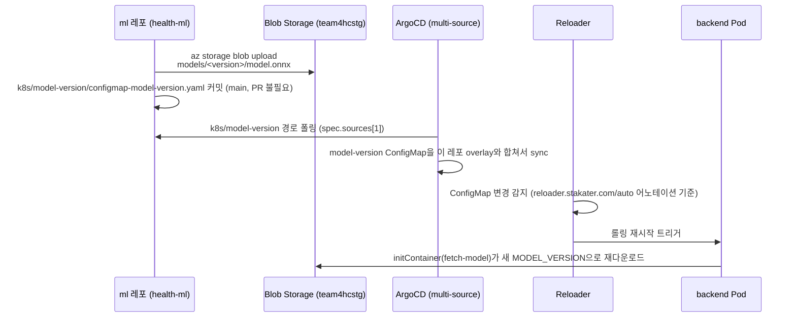

# 모델 버전 관리 (GitOps, ml 레포 직접 소스) — 브리프코치 피벗으로 폐기

> 이 문서는 옛 주제("크로스핏 폼 코치")의 TCN 자세판정 모델(ONNX)을 별도 `ml`(`health-ml`) 레포에서
> 학습·export해 이 클러스터의 backend Deployment로 자동 배포하던 GitOps 흐름을 그대로 보존한 기록이다.
> 2026-08-19 브리프코치 피벗으로 커스텀 모델 자체가 없어지면서 아래 전체(Reloader 설치,
> `fetch-model` Init Container, `model-cache` 볼륨, ArgoCD Application의 `spec.sources[1]`, ml 레포
> 접근용 Secret, `infra/.env`의 `ML_REPO_URL`)를 제거했다. 원래는 `infra/docs/kubernetes.md` §7이었다.

1. ml 레포가 로컬에서 학습을 마치면 `az storage blob upload`로 `models/<version>/model.onnx`를
   `team4hcstg` 스토리지 계정에 업로드한다.
2. ml 레포가 **자기 레포의** `k8s/model-version/configmap-model-version.yaml`(`MODEL_VERSION` 값)을
   바로 커밋한다 — **이 레포에 PR이 필요 없다**. ml팀이 소유한 별도 레포라 리뷰 없이 자기 파이프라인이
   바로 반영한다.
3. 이 레포의 ArgoCD Application 4개(`infra/k8s/apps/*.yaml`)가 전부 `spec.sources` 배열로
   구성돼 있어서, 1번째 소스(이 레포의 overlay)와 2번째 소스(ml 레포의 `k8s/model-version/`)를 **같은
   destination namespace**에 함께 적용한다. ArgoCD가 ml 레포의 커밋을 폴링해서 감지하면, 이 레포에
   아무 변경이 없어도 해당 네임스페이스의 `model-version` ConfigMap이 갱신된다.
4. K8s는 `envFrom: configMapRef`로 참조되는 ConfigMap의 **값**이 바뀌는 것 자체는 감지하지 않는다
   (참조 자체가 추가/삭제될 때만 diff로 인식) — 즉 ArgoCD가 ConfigMap을 갱신해도 이미 떠 있는 backend
   Pod는 재기동되지 않는다. 이 문제를 풀기 위해 **Reloader**(stakater, `infra/ansible/playbooks/
   bootstrap-cluster.yml`가 Helm으로 설치)를 도입했다. `base/backend/deployment.yaml`의
   `reloader.stakater.com/auto: "true"` 어노테이션을 Reloader가 보고, 참조 중인 ConfigMap 변경을
   감지해서 backend Deployment를 자동 롤링 재시작시킨다. 순수 Kustomize 트릭(예: `configMapGenerator`
   해시 서픽스)만으로는 **cross-repo**(ml 레포) 변경까지 커버할 수 없어서 정당화된 추가 컴포넌트로
   판단했다.
5. `rag-reindex` CronJob은 Reloader 대상이 아니다 — 매일 03:00에 항상 **새 Pod**로 뜨기 때문에
   재시작 트리거 없이도 그날그날 최신 `MODEL_VERSION` 값을 자연히 읽는다.
6. Deployment의 `fetch-model` initContainer가 `MODEL_VERSION`에 해당하는 blob을 내려받아
   `model-cache`(emptyDir)에 저장하고, 메인 컨테이너(`backend/app/inference/`)가 그걸 로드한다.
   결과적으로 **모델 바이너리 자체는 어느 git 레포에도 올라가지 않고**, 버전 태그만 GitOps로
   관리되되 그 git이 이 레포가 아니라 **ml 레포**다.

이전 설계(더 이전에 이미 폐기)는 이 레포의 `base/{backend,rag-cronjob}/`에
`configmap-model-version.yaml`을 직접 두고 PR로 갱신하는 방식이었는데, ml팀 입장에서 매번 이 레포에
PR을 올려야 하는 번거로움 + 수동 재시작 필요성 때문에 위 multi-source + Reloader 방식으로 바뀌었다.

## 재사용 가치가 있는 부분

- **cross-repo ConfigMap 변경 감지 + 자동 재시작 패턴**(Reloader) 자체는 일반적으로 유용한 기법이다 —
  나중에 비슷한 "다른 레포가 소유한 설정값을 GitOps로 구독" 상황이 생기면 참고할 만하다.
- Init Container에서 Workload Identity로 Azure CLI 인증하는 방법(`--federated-token`, IMDS 방식과
  다름)은 여전히 유효한 지식이고 `infra/docs/kubernetes.md` §5-1에 일반화해서 남겨뒀다.
